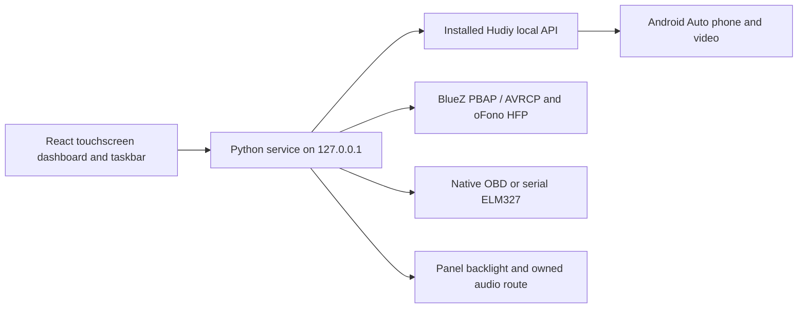

# Hudiy recreation

A touchscreen car dashboard built from observations of a running Hudiy installation and its public documentation. The interface is React and CSS, the gauges are drawn in code, and a Python service connects it to supported Pi and phone services.

This repository contains the independent application source. It does **not** contain the original Hudiy executable, proprietary source or assets, a phone's data, or a standalone Android Auto protocol implementation. The current Android Auto integration requires a separately installed, licensed Hudiy runtime. The dashboard can run locally without that runtime, with hardware features reported as unavailable.

The reference installation was Hudiy **1.24 / native API 1.3**, on a Raspberry Pi running **Debian 12 Bookworm with labwc**, with a **1280×720** touchscreen. That is the environment we actually tested; Raspberry Pi OS 13 was discussed but not verified. The interface adapts to other screen sizes rather than depending on those reference dimensions. This is an ongoing recreation, not a claim of complete or pixel-perfect compatibility.

## What we did

### 1. Observed the original application

We controlled the owner's Pi, inspected the running dashboard, menus and settings, and captured reference screens. We recorded geometry, navigation, colors, typography, screen states and behavior. Public Hudiy configuration and API documentation provided the supported integration points. Proprietary implementation code was not used as input.

The raw observations remain in the private development workspace. Captures can contain contacts, phone numbers, nearby Bluetooth identifiers and map locations, so they are not included in this public repository. This repository contains our code, the style specification, the backend rules and a summary of verification. See [clean-room policy](CLEAN_ROOM_POLICY.md).

### 2. Rebuilt the interface in code

We recreated the clock/navigation/music/phone dashboard, application menus, settings, music players, dialpad and five OBD views. Screenshots are reference evidence; they are not backgrounds used to fake a working application.

We added and corrected:

- Responsive landscape, narrow and portrait layouts, with content scrolling above the taskbar.
- Independent light/dark appearance preferences, with the selected accent applied across menus, controls and gauges.
- Touch scrolling that does not select interface text; moving a finger cancels a pending long press.
- Long-press customization, pinning shortcuts, and changing taskbar, application-tile and dashboard order.
- Durable Pi layout storage and synchronization between the dashboard and the taskbar web views.
- Separate configurable music and contact refresh intervals.
- Contact name filters: **All, A–F, G–L, M–R, S–Z and #** for other names/numbers. These replace the search field that required a keyboard.
- A consistent Pair menu with one **Pair device** action, which opens the installed Bluetooth pairing agent.
- Concise optional radio-output controls without accessory-specific instructions.
- Code-rendered gauges with bundled fonts, theme colors and indicators that follow finite readings. Missing data stays unavailable; Demo is explicitly labeled.
- A working application Quit path that returns to the desktop while preserving the saved settings and next-boot startup.

The visual rules are in [style.md](style.md).

### 3. Added the real backend and Pi launchers

The Python service provides a local HTTP API, validates actions, maintains bounded live data and saves supported preferences privately. We implemented two launch modes:

- **Standalone Qt application:** a frameless, fullscreen Qt WebEngine window hosting our dashboard.
- **Hudiy projection host:** starts our backend first, then the installed Hudiy runtime; registers the dashboard as a supported custom application and the taskbar as an overlay.

The projection host derives geometry from the current screen and preserves the original configuration in backups. The autostart installer makes reversible user-level labwc changes so the application starts after graphical login. On the reference Pi, an actual OS reboot restored the application and saved preferences.

Ignition was assumed to supply power to the Pi. We did **not** implement an ignition GPIO input, a controlled power-cut circuit or a shutdown controller.

### 4. Integrated Android Auto

The installed Hudiy runtime provides the real projection video. Our bridge uses its documented local API for supported actions, metadata and settings.

- Android Auto can occupy the area above our taskbar. Dashboard and Applications return to our interface while leaving the phone session running.
- A separate setting enables the fullscreen projection layout. Applying geometry changes requires a native runtime restart.
- **Open Android Auto automatically** controls whether a connected session takes over the display. Background metadata remains available when automatic opening is off.
- Music title, artist, album, duration, playback status and PNG/JPEG cover art populate the dashboard when supplied by the phone/runtime.
- Music/navigation details refresh every **5 seconds by default**, configurable from **1–60 seconds**.
- The Day/Night setting sends real native appearance commands. Common follows the Pi's theme; Day and Night force projection appearance. Day/Night requires negotiated API 1.3.
- Physical brightness writes the panel backlight independently of theme/contrast, so it affects Android Auto video too.
- USB recovery is limited to a uniquely validated Android accessory using the existing device permissions.
- Wireless projection uses the installed runtime's protected **5 GHz car hotspot**, allowing use away from a home router. Initial remote setup used Ethernet before switching the Pi's single Wi-Fi adapter to hotspot mode.
- We reproduced and fixed a wireless **Quit → Resume** failure by remembering the selected transport and using the saved hotspot setting for manual reconnection after startup.

Actual wireless projection with no USB accessory, background media, taskbar switching, Day/Night and manual reconnection were observed on the reference device. Live fullscreen video with the taskbar disabled, active turn-by-turn instructions and out-of-range recovery still need separate hardware checks.

### 5. Integrated Bluetooth phone services

Contacts and recent calls come from **BlueZ PBAP**, independently of USB Android Auto. The phone must already be paired and permit contact sharing. The reference phone supplied 94 contacts, 100 recent-call entries and no favorites. We fixed a stale OBEX-session bug so the service can recreate its own missing session without taking over another client's session.

Contact downloads default to **60 seconds**, configurable from **5–3600 seconds**. The interface checks completed results every five seconds and also provides manual Refresh. Filtering preserves the phone's order and groups accented names without keyboard entry.

Calling uses the existing **oFono HFP** service. Selecting a contact opens the dialpad; placing a call requires number confirmation. Available controls support Dial, incoming Answer, single-call Hangup and microphone mute. One authorized real outgoing test reached dialing/alerting and was hung up; no active call remained. Conversation audio, an incoming call and microphone behavior in a live conversation remain unverified.

Bluetooth music uses reported metadata and the connected phone's addressed **AVRCP** player. The dashboard follows the active Android Auto or Bluetooth source, while an explicitly selected local file retains ownership of its player. A short authorized Bluetooth Play/Pause check reported playing and then paused. Bluetooth cover art and audible output still depend on the phone/player/stack and have not been verified end to end.

The Connections menu provides real paired-device Connect/Disconnect and opt-in automatic reconnect. Retries are limited to once per device every 30 seconds. Disconnect and unpairing have confirmations; pairing/PIN approval is handled by the installed agent. No device is paired or trusted automatically.

### 6. Added required OBD vehicle data support

**Bluetooth ELM327 vehicle data is required for this project. The separate Bluetooth radio audio receiver is optional.**

We added native Bluetooth Serial Port adapter selection, RFCOMM channel controls (1–30), serial/USB presets and read-only Mode 01 polling. COM2 is a serial port name; it is not the same thing as RFCOMM channel 2. BLE-only adapters are currently unsupported.

The native monitor follows the runtime's actual OBD connection every five seconds. When connected it starts supported reads; failed queries retry at most every 30 seconds. Disconnect clears old readings/history. Manual Stop suppresses monitoring for the current service session, and selecting serial/USB takes precedence.

Supported values are engine load, coolant temperature, RPM, speed, throttle and control-module voltage. Views include OBD Charts, OBD Blocks, Combined and two gauge layouts. A loopback simulator is supported for development; simulated data does not count as a real vehicle test.

The reference adapter was paired and its cached Serial Port advertisement matched the configured RFCOMM channel 2, but it was unreachable during verification. **Live vehicle readings have not yet been verified.** The service sends only its fixed initialization/read-only sensor allowlist; it does not offer arbitrary CAN/ECU commands or fault clearing.

### 7. Added audio support

Local audio supports file selection, playback, seeking and playlist navigation. Its 15-band Web Audio equalizer and stereo balance affect that selected local file, with offline signal checks for the audio graph.

Sound can optionally save a separate paired Bluetooth A2DP receiver for the car radio. The Pi remains the middleman: the routing worker manages only the installed Hudiy equalizer/echo chain it can identify as owned by that runtime. It checks the route every five seconds and can restore it after reconnection. Selecting a receiver does not start playback, pair it, or change unrelated streams.

No radio receiver was selected for the final checks. Audible music, navigation and calls through such a receiver remain unverified. UI equalizer preset choices have not been wired to the native projection equalizer; multichannel fade/subwoofer hardware, FM tuner audio and CarPlay/Autobox integration remain incomplete.

## Architecture



| Path | Purpose |
| --- | --- |
| `implementation/dashboard/src/` | React interface, theme, touch gestures, layout, gauges and local audio graph |
| `implementation/dashboard/tests/` | Contact-filter, layout, media-source and static-hosting tests |
| `implementation/dashboard/worker/` and `.openai/` | Optional static frontend packaging; this does not host Pi hardware services |
| `implementation/dashboard/qa/audio-dsp-check.html` | Local offline audio-graph check |
| `implementation/service/` | Local API, native protocol bridge, OBD, Bluetooth, phonebook, calls, settings and audio routing |
| `implementation/launcher/` | Standalone Qt launcher, native projection host and reversible autostart installer |
| `docs/backend-rules.md` | Exact API boundaries, device checks and persistence rules |
| `docs/VERIFICATION.md` | What was tested and what remains unverified |
| `SECURITY.md` / `CLEAN_ROOM_POLICY.md` / `style.md` | Security constraints, observation policy and visual specification |

## Run locally

Use Python 3.10+ and a Node version supported by the locked frontend dependencies (Node **20.19+ in the 20.x line**, or **22.12+**). npm is required. Python serial support uses the pinned `pyserial` requirement; native phone/projection features are Pi-only.

From the repository root:

```sh
python -m pip install -r implementation/service/requirements.txt
cd implementation/dashboard
npm ci
npm run build
cd ../..
python implementation/service/server.py
```

Open [http://127.0.0.1:8766/](http://127.0.0.1:8766/). The backend serves the built dashboard on loopback. Without the Pi projection host, live phone/hardware controls report unavailable instead of inventing data.

For frontend development, keep the backend running and use a second terminal:

```sh
cd implementation/dashboard
npm run dev -- --host 127.0.0.1 --port 4173 --strictPort
```

Open [http://127.0.0.1:4173/](http://127.0.0.1:4173/). Vite proxies `/api` to the local service on port 8766. Do not start a second backend on a port already occupied by an SSH tunnel or another service.

## Run on the Raspberry Pi

Build the frontend first. Install the Pi distribution's Qt WebEngine, serial, D-Bus/GObject and OBEX packages if absent:

```sh
sudo apt install python3-pyqt6 python3-pyqt6.qtwebengine python3-serial python3-dbus python3-gi bluez-obexd
```

Copy or clone this source and include the generated `implementation/dashboard/dist/client` build. Run from the logged-in graphical session. Native calling/routing requires the existing BlueZ, oFono and PipeWire services to be configured; these scripts do not configure a complete phone/audio stack from scratch.

### Standalone dashboard

```sh
python3 implementation/launcher/launcher.py
```

The launcher starts the backend if needed and opens a fullscreen window. **Ctrl+Alt+Shift+Q** exits this standalone window for maintenance. Real Android Auto and the native pairing handoff are available through the projection-host mode below.

### Dashboard with installed Hudiy projection

The licensed runtime must already exist at the current user's `~/.hudiy/share/hudiy_run.sh`. Stop another recreation host/backend before starting a new one.

```sh
# Review the screen-derived configuration without writing it.
python3 implementation/launcher/hudiy_host.py

# Apply the supported configuration and launch the host/runtime.
python3 implementation/launcher/hudiy_host.py --apply
```

Original native configuration is preserved in `.recreation-original` backups. The backend starts before the native runtime so its custom web-view URLs are ready. Use the application's **Quit** button to exit this mode; the standalone keyboard shortcut does not apply to it.

### Startup after boot/login

For the installed native projection host:

```sh
python3 implementation/launcher/install_autostart.py --projection-host
python3 implementation/launcher/install_autostart.py --projection-host --apply
```

The first command prints a dry run. Applying backs up the labwc files and replaces the single expected original Hudiy startup line with the recreation host. It refuses an existing recreation block or an unexpected startup layout; inspect those files before reinstalling. For standalone Qt mode, omit `--projection-host` and review the original Hudiy startup separately, since that mode does not disable it.

Autostart takes effect on the next graphical login, so boot startup assumes a configured graphical login session. It does not make the Pi shut down safely when ignition power disappears.

## Settings and privacy

On the projection host, supported preferences are stored under `~/.local/share/hudiy-recreation/`, including layout, refresh intervals, projection options, brightness, Bluetooth reconnect selection and optional radio output. Saves are atomic/private on Linux; durable layout/settings saves flush before acknowledgement. The standalone browser preview uses local browser preferences for appearance/layout.

Phonebook and current-call data stay in bounded memory; temporary PBAP transfers are deleted and caches clear when the phone disconnects. Credentials, contact exports, raw captures, generated builds, dependencies, local configs and research data are excluded from Git.

The backend binds to **127.0.0.1** and is designed for a local application, not an internet service. It checks Host/origin, limits JSON action bodies to 4096 bytes and validates fixed actions/device ownership. No external Firebase/Supabase rules are involved. Read the full [backend rules](docs/backend-rules.md) and [security notes](SECURITY.md) before changing those boundaries.

## Tests and observed results

From the repository root:

```sh
python -m unittest discover -s implementation/service -p 'test_*.py'
cd implementation/dashboard
npm ci
npm run build
node --test tests/*.test.mjs
npm audit --omit=dev --audit-level=high
```

The latest publication check passes **79 backend tests** and **13 frontend/packaging tests**. The production build passes and the dependency audit reports **zero known production vulnerabilities at the time checked**. That is not a guarantee that the application has no security bugs.

Tests cover bounded sensor/protocol handling, source changes and artwork invalidation, connection recovery, preference validation and rollback, layout persistence, calls with mocks, phonebook session ownership, audio routing ownership, host/origin/injection rejection and touch-filter grouping. Automated tests do not place real calls, remove real pairings or verify vehicle hardware.

Manual checks on the reference Pi include fullscreen launch, an actual OS reboot, matching saved-preference hashes before/after restart, real wireless Android Auto video, taskbar navigation, native Day/Night, kernel backlight changes, contact synchronization, an authorized outgoing call/hangup, Bluetooth Play/Pause and the latest filters/Pair/Sound changes. Browser checks cover sizes from 320×568 through 1920×720. See [verification and remaining work](docs/VERIFICATION.md).

## Remaining work

1. Validate required live OBD readings and reconnection with the adapter powered in a real vehicle.
2. Validate fullscreen Android Auto with the taskbar disabled, active navigation, out-of-range recovery and the complete ignition/power lifecycle.
3. Test the optional Bluetooth radio receiver and incoming/conversation audio, and connect native equalizer settings where supported.

CarPlay/Autobox, FM tuner playback, notification integration and a real marketplace catalog are not implemented. A visible menu entry does not prove its hardware integration exists.

## License and public references

This repository retains its [MIT license](LICENSE). Third-party packages keep their own licenses. The original Hudiy runtime is not distributed here, and this repository's license does not license that runtime.

- [Hudiy public API](https://github.com/wiboma/hudiy/blob/main/api/Api.proto) — native integration messages.
- [Hudiy main configuration](https://github.com/wiboma/hudiy/blob/main/main_configuration.md) — native configuration compatibility target.
- [Hudiy Raspberry Pi documentation](https://github.com/wiboma/hudiy/blob/main/raspberry_pi.md) — upstream installation reference.

Public upstream documentation can describe a different version from the tested 1.24/API 1.3 installation. Check compatibility before applying it to another runtime.
