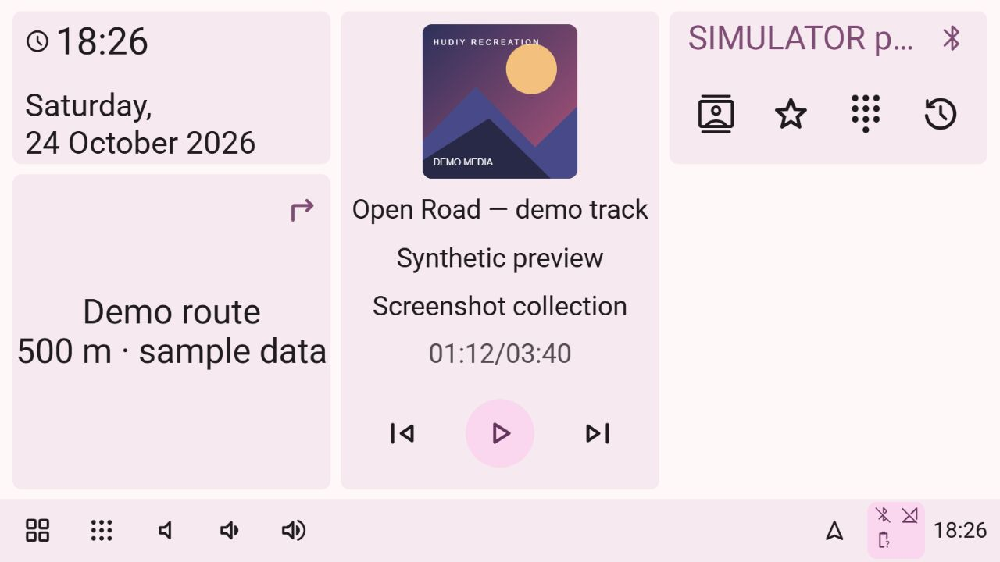
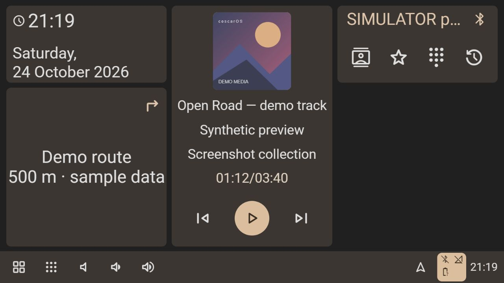
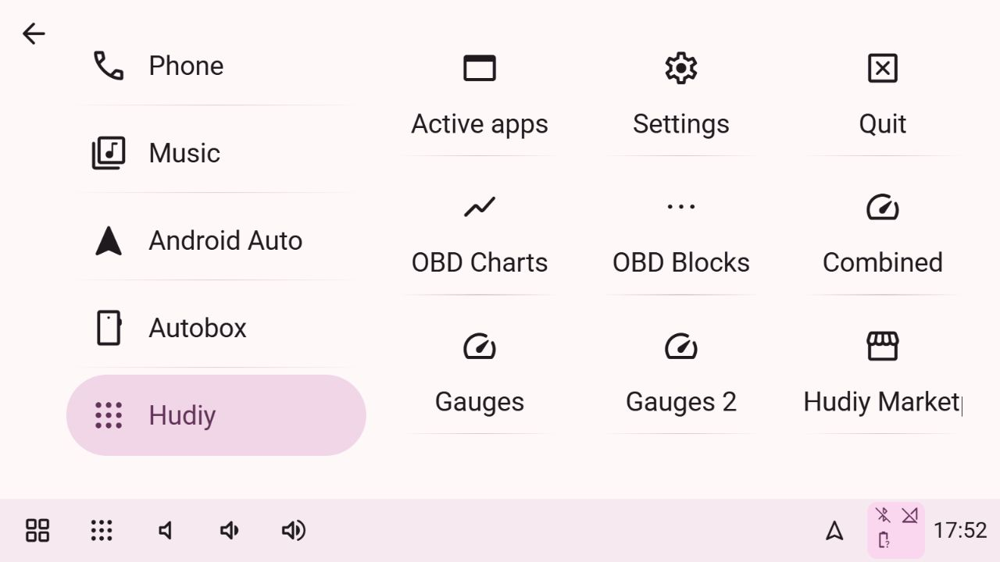
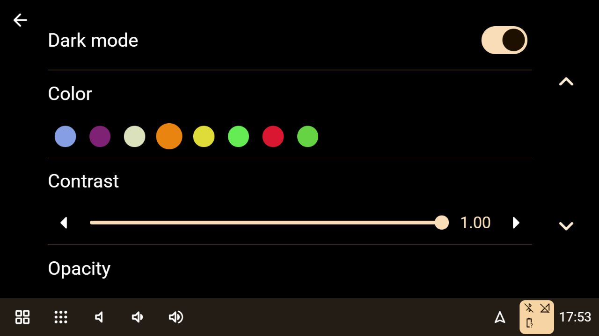
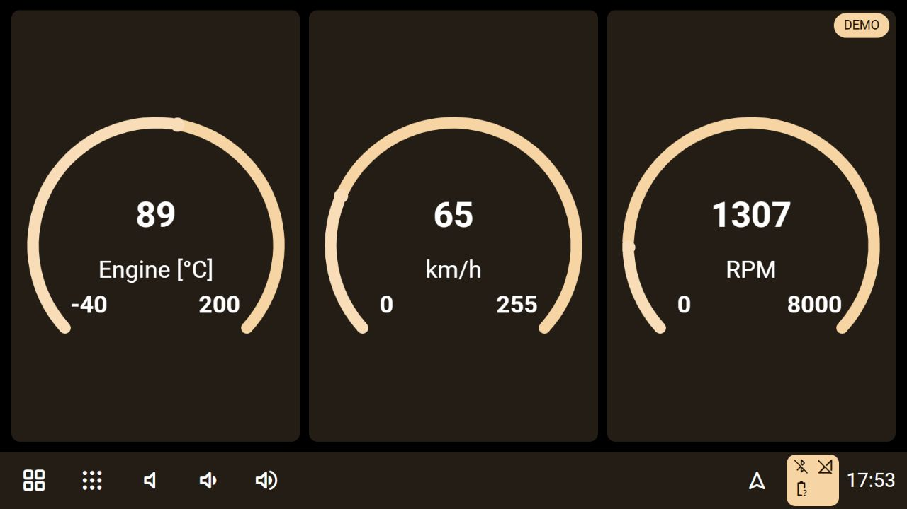
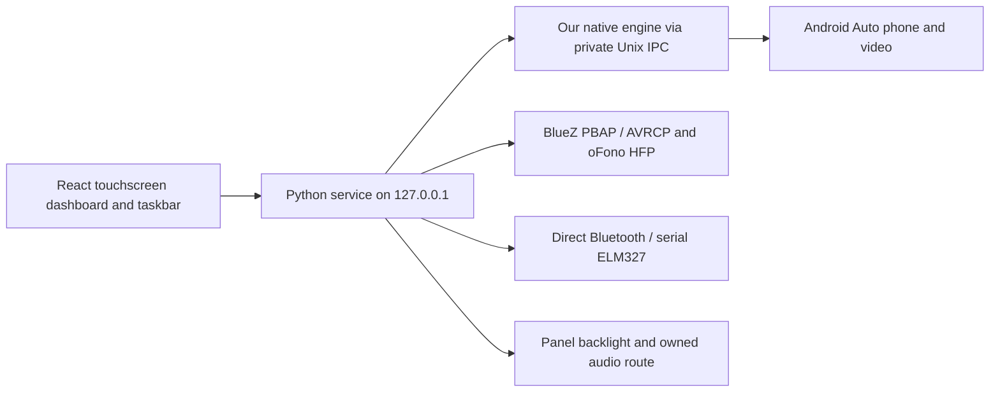

# Hudiy recreation

**An independent Raspberry Pi car dashboard, rebuilt from observed Hudiy behavior.**

React touchscreen UI · Python hardware service · Qt fullscreen host · USB & wireless Android Auto

[](docs/images/dashboard-light.jpg)

*Our application running in a local browser. The phone, track and route are synthetic screenshot data; this image is not a live vehicle test.*

## Contents

- [Introduction](#introduction)
- [Screenshot gallery](#screenshot-gallery)
- [What we rebuilt and corrected from Hudiy](#what-we-rebuilt-and-corrected-from-hudiy)
  - [Observing the original](#1-observed-the-original-application)
  - [Rebuilt interface and corrections](#2-rebuilt-the-interface-in-code)
  - [Backend and Pi startup](#3-added-the-real-backend-and-pi-launchers)
  - [Android Auto](#4-integrated-android-auto)
  - [Bluetooth phone services](#5-integrated-bluetooth-phone-services)
  - [Required OBD vehicle data](#6-added-required-obd-vehicle-data-support)
  - [Audio support](#7-added-audio-support)
- [Architecture](#architecture)
- [Run locally](#run-locally)
- [Easy Pi installation](#easy-pi-installation)
- [Run on the Raspberry Pi](#run-on-the-raspberry-pi)
- [Settings and privacy](#settings-and-privacy)
- [Tests and observed results](#tests-and-observed-results)
- [Remaining work checklist](#remaining-work)
- [Clean-room approach and legal basis](#clean-room-approach-and-legal-basis)
- [License and public references](#license-and-public-references)

## Introduction

The project started with the owner's original Hudiy installation: inspect its screens and interactions, document what they do, and implement a usable car application independently. The aim is to preserve that familiar dashboard while making touch navigation, customization and device integration practical on our Pi.

A touchscreen car dashboard built from observations of a running Hudiy installation and its public documentation. The interface is React and CSS, the gauges are drawn in code, and a Python service connects it to supported Pi and phone services.

The default Pi launcher now starts **our own native application and Android Auto protocol engine**, with a separately licensed, pinned open-source protocol library. It does not launch or connect to the proprietary Hudiy runtime. Our React interface, taskbar, Python backend, Bluetooth pairing, ELM327 selection and wireless settings remain under our application's control.

The standalone engine has displayed real USB and wireless Android Auto video from the owner's phone with proprietary Hudiy stopped and its API port absent. Taskbar switching, Quit/Resume, taskbar hiding, live cover art, Day/Night and physical brightness have been checked on our engine. An actual Pi reboot loaded our app and preserved preferences. We corrected USB accessory identification and a post-reboot service-discovery failure when no microphone device existed. USB and wireless now deliver decoded video again. See [standalone verification](docs/STANDALONE.md). The previous Hudiy API bridge and compatibility launcher have now been removed; only our independent runtime is supported. See [dependency inventory](docs/HUDIY_DEPENDENCIES.md).

The reference installation was Hudiy **1.24 / native API 1.3**, on a Raspberry Pi running **Debian 12 Bookworm with labwc**, with a **1280×720** touchscreen. That is the environment we actually tested; Raspberry Pi OS 13 was discussed but not verified. The interface adapts to other screen sizes rather than depending on those reference dimensions. This is an ongoing recreation, not a claim of complete or pixel-perfect compatibility.

## Screenshot gallery

These are fresh screenshots of **our rendered React application**, captured on 10 October 2026 at 1280×720. The light theme follows the observed Hudiy reference; the dark amber theme demonstrates our global accent controls. Click any image to open it at full size.

| 🌙 Dark dashboard | 🧭 Application menu |
| --- | --- |
| [](docs/images/dashboard-dark.jpg) | [](docs/images/applications.jpg) |
| Same clock, navigation, music and phone layout with a different palette. | Rebuilt category navigation, settings entry and OBD view selection. |

| 🎨 Theme controls | 🚗 OBD gauges — DEMO |
| --- | --- |
| [](docs/images/theme-settings.jpg) | [](docs/images/obd-gauges-demo.jpg) |
| Accent colors reach the controls, panels and taskbar. | The application's existing Demo mode supplies simulated values. |

**Screenshot scope:** the gallery preview used a separate read-only local fixture server, with no Pi proxy or hardware actions. Demo artwork was drawn specifically for this gallery. No real contacts, device addresses, location, phone artwork or Wi-Fi credentials are included. A visible menu entry or demo value does not establish hardware support; [verification](#tests-and-observed-results) and the [remaining work](#remaining-work) describe the actual status.

## What we rebuilt and corrected from Hudiy

The comparison below uses the **original Hudiy 1.24 installation** as the reference. “Rebuilt” describes behavior we observed and implemented ourselves. “Added/corrected” describes changes to **our recreation**, including issues reported while testing it; it does not claim that the original Hudiy has those bugs.

| Original Hudiy reference | What we rebuilt | What we added or corrected in our version |
| --- | --- | --- |
| Clock, destination, music and phone cards with a bottom taskbar | The dashboard structure, rounded cards, spacing, typography and shortcuts | Responsive layouts, full accent propagation and touch scrolling |
| Category menus, settings rows, switches, sliders and color choices | The navigation hierarchy and familiar control shapes | Consistent Pair screen, one discovery action and shorter radio-output controls |
| Taskbar shortcuts and app navigation | Working navigation between dashboard, menus and players | Long-press pinning/reordering and durable settings across Pi reboots |
| Android Auto projection and its connection/settings menus | USB/Wi-Fi entry points, Resume/Quit and phone projection | Our own open-source-based engine; persistent taskbar or fullscreen choice; separate reconnect and automatic-opening settings |
| Music, contacts, favorites, call history and dialpad screens | Player controls, phonebook views and calling interface | Keyboard-free name filters, configurable refresh intervals and real Bluetooth service adapters |
| OBD Charts, Blocks, Combined and two gauge layouts | Code-rendered telemetry views | Direct read-only Bluetooth ELM327 polling, adapter/channel selection and explicit unavailable/demo states |
| Sound, equalizer and output settings | Sound controls and local-file equalizer/balance | Optional Bluetooth-to-radio routing and our own persistent native projection equalizer/balance |
| Fullscreen Pi application and startup workflow | Our own fullscreen Qt host and graphical-login launcher | Independent runtime ownership and an application Quit path back to the desktop |

The following sections explain the implementation and its limits. The [style specification](style.md) records the visual observations and intentional changes; the [public Hudiy repository](https://github.com/wiboma/hudiy) provides upstream documentation.


### 1. Observed the original application

We controlled the owner's Pi, inspected the running dashboard, menus and settings, and captured reference screens. We recorded geometry, navigation, colors, typography, screen states and behavior. Public Hudiy configuration and API documentation provided the supported integration points. Proprietary implementation code was not used as input.

The raw observations remain in the private development workspace. Captures can contain contacts, phone numbers, nearby Bluetooth identifiers and map locations, so they are not included in this public repository. This repository contains our code, the style specification, the backend rules and a summary of verification. See [clean-room policy](CLEAN_ROOM_POLICY.md).

### 2. Rebuilt the interface in code

We recreated the clock/navigation/music/phone dashboard, application menus, settings, music players, dialpad and five OBD views. Screenshots are reference evidence; they are not backgrounds used to fake a working application.

We added and corrected:

- Responsive landscape, narrow and portrait layouts, with content scrolling above the taskbar.
- Independent light/dark appearance preferences, with the selected accent applied across menus, controls and gauges.
- Touch scrolling that does not select interface text; moving a finger cancels a pending long press.
- Long-press customization, pinning shortcuts, and changing taskbar, application-tile and dashboard order.
- Durable Pi layout storage and synchronization between the dashboard and the taskbar web views.
- Separate configurable music and contact refresh intervals.
- Contact name filters: **All, A–F, G–L, M–R, S–Z and #** for other names/numbers. These replace the search field that required a keyboard.
- A consistent Pair menu with one discovery action, a pairing action for each discovered device, and our own pairing-code/PIN confirmation dialog.
- Concise optional radio-output controls without accessory-specific instructions.
- Code-rendered gauges with bundled fonts, theme colors and indicators that follow finite readings. Missing data stays unavailable; Demo is explicitly labeled.
- A working application Quit path that returns to the desktop while preserving the saved settings and next-boot startup.

The visual rules are in [style.md](style.md).

### 3. Added the real backend and Pi launchers

The Python service provides a local HTTP API, validates actions, maintains bounded live data and saves supported preferences privately. The native Qt 6.4+ application owns two web views (content and taskbar), an Android Auto video surface, the protocol session, USB transport, car Wi-Fi listener, audio playback and microphone capture.

The launcher prevents a second application owner. The native process starts and owns the Python service and uses a private user-only Unix socket for commands and live events. Quit closes our own application and its backend. The reversible labwc installer selects our launcher after graphical login and retains startup/configuration backups.

Ignition was assumed to supply power to the Pi. We did **not** implement an ignition GPIO input, a controlled power-cut circuit or a shutdown controller.

### 4. Integrated Android Auto

Our own native executable links `prodigy-oaa-protocol`, pinned to a documented open-source revision. It negotiates an Android Auto session and handles H.264 video, PCM media/speech/system audio, touch/multitouch, microphone input and media/navigation status channels. USB accessory negotiation is implemented in our bounded libusb transport. Wireless setup uses our own BlueZ profile and the operator's protected NetworkManager car hotspot.

- The video surface sits above our taskbar, with Dashboard/Applications switching back to our web interface while the session stays connected.
- The taskbar setting changes the advertised video/touch viewport and reconnects the session; the application stays running.
- Automatic opening is separate from background connection/data collection.
- Android Auto settings offer per-phone automatic Bluetooth reconnect On/Off, independently of automatic opening. These choices use the same privately saved paired-device preferences as Connections.
- Five-second connection checks and event-driven phone metadata feed the backend; the existing music/contact refresh settings remain configurable.
- Day/Night is sent through the Android Auto sensor channel. Physical brightness still writes the real panel backlight.
- Quit stops connection admission until manual USB/Wi-Fi/Resume. USB and Wi-Fi select their respective transport. USB pauses the competing wireless bootstrap; its reconnect targets only one uniquely identified Android accessory, runs outside the UI thread and has a 15-second cooldown. Wired Quit/Resume has been checked without unplugging the cable. Resume can retrigger the owned wireless handshake.
- The audio-input protocol service remains present without a physical microphone. Actual capture requests fail explicitly when no supported input exists; no fabricated microphone audio is sent. Public status separates decoded video readiness from protocol connection and reports microphone availability.
- Pairing confirmations are handled in our own UI; wireless credentials are never returned by the HTTP API or written to logs.

The executable builds on the actual Bookworm Pi 5. [docs/STANDALONE.md](docs/STANDALONE.md) records genuine USB and wireless video on our engine separately from historical tests of the old bridge. Physical multitouch, microphone audio and guided navigation still need hardware verification.

### 5. Integrated Bluetooth phone services

Contacts and recent calls come from **BlueZ PBAP**, independently of USB Android Auto. The phone must already be paired and permit contact sharing. The reference phone supplied 94 contacts, 100 recent-call entries and no favorites. We fixed a stale OBEX-session bug so the service can recreate its own missing session without taking over another client's session.

Contact downloads default to **60 seconds**, configurable from **5–3600 seconds**. The interface checks completed results every five seconds and also provides manual Refresh. Filtering preserves the phone's order and groups accented names without keyboard entry.

Calling uses the existing **oFono HFP** service. Selecting a contact opens the dialpad; placing a call requires number confirmation. Available controls support Dial, incoming Answer, single-call Hangup and microphone mute. One authorized real outgoing test reached dialing/alerting and was hung up; no active call remained. Conversation audio, an incoming call and microphone behavior in a live conversation remain unverified.

Bluetooth music uses reported metadata and the connected phone's addressed **AVRCP** player. The dashboard follows the active Android Auto or Bluetooth source, while an explicitly selected local file retains ownership of its player. A short authorized Bluetooth Play/Pause check reported playing and then paused. Bluetooth cover art and audible output still depend on the phone/player/stack and have not been verified end to end.

The Connections menu provides paired-device Connect/Disconnect and opt-in automatic reconnect. Retries are limited to once per device every 30 seconds. Android Auto settings expose the same choice for phones advertising PBAP. Disconnect and unpairing have confirmations; our own agent handles numeric/PIN approval. An explicitly selected successful pairing is marked trusted. The automatic reconnect worker neither pairs devices nor grants trust.

### 6. Added required OBD vehicle data support

**Bluetooth ELM327 vehicle data is required for this project. The separate Bluetooth radio audio receiver is optional.**

We added native Bluetooth Serial Port adapter selection, RFCOMM channel controls (1–30), serial/USB presets and read-only Mode 01 polling. COM2 is a serial port name; it is not the same thing as RFCOMM channel 2. BLE-only adapters are currently unsupported.

Our backend opens the selected Bluetooth adapter directly through RFCOMM and starts supported reads. Failed connections retry at most every 30 seconds. Disconnect clears old readings/history. Manual Stop suppresses monitoring for the current service session, and selecting serial/USB takes precedence. A manual Bluetooth read keeps the required automatic reconnect monitor enabled.

Supported values are engine load, coolant temperature, RPM, speed, throttle and control-module voltage. Views include OBD Charts, OBD Blocks, Combined and two gauge layouts. A loopback simulator is supported for development; simulated data does not count as a real vehicle test.

The reference adapter was paired and its cached Serial Port advertisement matched the configured RFCOMM channel 2, but it was unreachable during verification. **Live vehicle readings have not yet been verified.** The service sends only its fixed initialization/read-only sensor allowlist; it does not offer arbitrary CAN/ECU commands or fault clearing.

### 7. Added audio support

Local audio supports file selection, playback, seeking and playlist navigation. Its 15-band Web Audio equalizer and stereo balance affect that selected local file, with offline signal checks for the audio graph.

Sound can optionally save a separate paired Bluetooth A2DP receiver for the car radio. The Pi remains the middleman: our worker routes playback belonging to our native process or the single connected paired phone. It checks every five seconds, waits during calls and verifies the changed route on a later poll. It can select the receiver as the default output; it does not move unrelated active streams. Selecting a receiver does not start playback or pair it. No proprietary equalizer/echo chain is required.

No radio receiver was selected for the final checks. Audible music, navigation and calls through such a receiver remain unverified. The native projection output now processes the same 15-band equalizer curve and stereo balance. Media/speech/system PCM use owned processors with peak bounds; balance leaves mono speech intact. Settings save privately, synchronize across our two web views, and reload on app restart. Flat is signal-identical in tests. Our practical preset curves replace the previous placeholder curves; they are not claimed to match proprietary Hudiy preset values. Multichannel fade/subwoofer hardware, Bluetooth AVRCP DSP, FM tuner audio and CarPlay/Autobox integration remain incomplete.

Native projection audio now feeds its sinks from a dedicated worker, separate from GUI/video decoding. A silent-sink test with repeated 120 ms GUI stalls reproduced 391,808 dropped bytes in the old implementation; the worker delivered every submitted byte with no drops and an empty final queue. The reference Pi was restarted into this revision and wireless video/audio counters recovered with our taskbar intact. These are transport/buffering checks, not audible car-radio evidence. See [audio verification](docs/STANDALONE.md#dedicated-audio-worker--10-october-2026).

## Architecture



| Path | Purpose |
| --- | --- |
| `implementation/dashboard/src/` | React interface, theme, touch gestures, layout, gauges and local audio graph |
| `implementation/dashboard/tests/` | Contact-filter, layout, media-source and static-hosting tests |
| `implementation/dashboard/worker/` and `.openai/` | Optional static frontend packaging; this does not host Pi hardware services |
| `implementation/dashboard/qa/audio-dsp-check.html` | Local offline audio-graph check |
| `implementation/service/` | Local API, owned native IPC, direct Bluetooth/serial OBD, Bluetooth agent, phonebook, calls and audio routing |
| `implementation/native/` | GPL native fullscreen host, USB transport and pinned open-source Android Auto protocol dependency |
| `implementation/launcher/` | Independent native launcher and reversible autostart installer; no proprietary-runtime fallback |
| `docs/backend-rules.md` | Exact API boundaries, device checks and persistence rules |
| `docs/VERIFICATION.md` | What was tested and what remains unverified |
| `SECURITY.md` / `CLEAN_ROOM_POLICY.md` / `style.md` | Security constraints, observation policy and visual specification |

## Run locally

Use Python 3.10+ and a Node version supported by the locked frontend dependencies (Node **20.19+ in the 20.x line**, or **22.12+**). npm is required. Python serial support uses the pinned `pyserial` requirement; native phone/projection features are Pi-only.

From the repository root:

```sh
python -m pip install -r implementation/service/requirements.txt
cd implementation/dashboard
npm ci
npm run build
cd ../..
python implementation/service/server.py
```

Open [http://127.0.0.1:8766/](http://127.0.0.1:8766/). The backend serves the built dashboard on loopback. Without the Pi projection host, live phone/hardware controls report unavailable instead of inventing data.

For frontend development, keep the backend running and use a second terminal:

```sh
cd implementation/dashboard
npm run dev -- --host 127.0.0.1 --port 4173 --strictPort
```

Open [http://127.0.0.1:4173/](http://127.0.0.1:4173/). Vite proxies `/api` to the local service on port 8766. Do not start a second backend on a port already occupied by an SSH tunnel or another service.

## Easy Pi installation

On **64-bit Raspberry Pi OS Desktop (Bookworm or Trixie)**, open a terminal as your ordinary desktop user:

```sh
bash -o pipefail -c 'curl -fsSL https://raw.githubusercontent.com/EpicNori/clean-room-reverse-engeenering-hudiy/main/install.sh | bash'
```

The guided installer shows its plan, installs OS dependencies, checks/downloads a private Node runtime, builds/tests our frontend and native receiver, configures Bluetooth/audio/device access, selects startup and prepares an inactive protected hotspot. Default setup enables desktop autologin; `--no-autologin` preserves login authentication. It does not reboot or switch Wi-Fi automatically. See [installation, options and recovery](docs/INSTALL.md). A full freshly flashed image/reboot test is still pending.

## Run on the Raspberry Pi

Build the frontend first, then install the native build/runtime dependencies:

```sh
sudo apt install build-essential cmake pkg-config qt6-base-dev qt6-multimedia-dev qt6-webengine-dev qt6-connectivity-dev \
  libprotobuf-dev protobuf-compiler libssl-dev libusb-1.0-0-dev libavcodec-dev libavutil-dev libswscale-dev \
  python3-serial python3-dbus python3-gi bluez bluez-obexd network-manager
cmake -S implementation/native -B implementation/native/build -DCMAKE_BUILD_TYPE=Release
cmake --build implementation/native/build -j3
python3 implementation/launcher/launcher.py
```

CMake fetches the pinned protocol source and its exact protobuf submodule. The normal launcher requires this binary and refuses an already occupied backend port; it does not silently fall back to Hudiy. Run in the logged-in Wayland graphical session. **Ctrl+Alt+Shift+Q** and the application's **Quit** exit our window and backend.

BlueZ/PBAP, oFono HFP and PipeWire are standard system services. The existing calling/audio setup on the reference Pi is reused; a fresh device still needs those services configured. Our Bluetooth ELM327 worker owns its own RFCOMM socket and polls only allowlisted read-only sensor PIDs. OBD is required; the separate A2DP radio receiver remains optional.

Wireless Android Auto needs a protected 5 GHz NetworkManager AP named `hudiy-recreation-car`, with a private `~/.local/share/hudiy-recreation/wireless.json` describing its SSID/key and fixed gateway `192.168.12.1`. The reference Pi migration cloned the owner's existing AP profile and copied only Wi-Fi/OBD preferences into our private files; subsequent runtime operation does not read the old Hudiy configuration. Fresh protected hotspot preparation is available through `python3 implementation/launcher/provision_hotspot.py` (read-only check) and `--apply` (create inactive profile). Run as the desktop user with our app quit for first-time setup, then start our app and enable Car Wi-Fi. See [hotspot setup and verified limits](docs/HOTSPOT_SETUP.md). Complete clean-image provisioning remains unverified. Do not commit credentials. Initial remote network setup must preserve Ethernet or another recovery connection.

For boot/login startup:

```sh
python3 implementation/launcher/install_autostart.py
python3 implementation/launcher/install_autostart.py --apply
```

The first command prints the exact changes. Applying retains timestamped backups, replaces the managed recreation startup block, disables the exact previous Hudiy startup line if present and adds a labwc rule for our own application. Graphical autologin is assumed. Ignition/power-loss shutdown remains separate hardware work.

The official Hudiy host/API/configuration bridge has been removed from production source. `HUDIY_PROJECTION_HOST` no longer enables an alternative runtime. The normal launcher runs only our native application; desktop preview keeps Pi controls unavailable.

## Settings and privacy

In the independent Pi application, supported preferences are stored under `~/.local/share/hudiy-recreation/`, including layout, refresh intervals, projection options, brightness, Bluetooth reconnect selection and optional radio output. Saves are atomic/private on Linux; durable layout/settings saves flush before acknowledgement. The standalone browser preview uses local browser preferences for appearance/layout.

Phonebook and current-call data stay in bounded memory; temporary PBAP transfers are deleted and caches clear when the phone disconnects. Credentials, contact exports, raw captures, generated builds, dependencies, local configs and research data are excluded from Git.

The backend binds to **127.0.0.1** and is designed for a local application, not an internet service. It checks Host/origin, limits JSON action bodies to 4096 bytes and validates fixed actions/device ownership. No external Firebase/Supabase rules are involved. Read the full [backend rules](docs/backend-rules.md) and [security notes](SECURITY.md) before changing those boundaries.

## Tests and observed results

From the repository root:

```sh
python -m unittest discover -s implementation/service -p 'test_*.py'
cd implementation/dashboard
npm ci
npm run build
node --test tests/*.test.mjs
npm audit --omit=dev --audit-level=high
```

Earlier checkpoints passed 79 backend/13 frontend and 96 backend/14 frontend checks. The standalone-only cleanup passed 92 backend checks. The installer adds 11 checks: all 103 installer-era backend checks passed on a clean Pi source snapshot. The audio-worker revision passes all 104 backend checks directly in the cleaned Pi deployment; Windows skips the three Linux/symlink checks. The unchanged frontend has **16 frontend/packaging tests**. The current native revision compiles on the reference Pi and passes both CTest checks: DSP signals and bounded audio queues. An explicit opt-in silent-sink stress probe covers delivery during GUI stalls. Tests for the removed licensed bridge were retired; their OBD/audio regressions now exercise our direct transports. The same DSP signal check passed with AddressSanitizer and UndefinedBehaviorSanitizer on the Pi. The production dependency audit was rerun on 10 October 2026 and reported zero known vulnerabilities. A passing test suite is not a guarantee that the application has no security bugs.

Tests cover bounded sensor/protocol handling, source changes and artwork invalidation, connection recovery, preference validation and rollback, layout persistence, calls with mocks, phonebook session ownership, audio routing ownership, host/origin/injection rejection and touch-filter grouping. Automated tests do not place real calls, remove real pairings or verify vehicle hardware.

Historical checks of the licensed bridge included contact synchronization, an authorized outgoing call/hangup and Bluetooth Play/Pause. Our standalone checks include real wireless projection, taskbar navigation, Android Auto Quit/Resume, both taskbar layouts, Day/Night, live media/artwork, backlight writes and actual reboot startup with matching saved-preference hashes. The new per-phone reconnect switch was checked against its private saved file in both states. See [current standalone evidence](docs/STANDALONE.md); [docs/VERIFICATION.md](docs/VERIFICATION.md) retains the earlier history. Earlier browser checks covered sizes from 320×568 through 1920×720.

## Remaining work

Unchecked items are still incomplete or require hardware verification. The gallery's demo gauges do not complete the OBD checks.

### Required car functionality and verification

- [ ] Verify required live Bluetooth ELM327 readings with the adapter powered in a real vehicle.
- [ ] Verify OBD disconnect/reconnect and stale-data clearing during vehicle use.
- [ ] Verify active navigation instructions and speech through our standalone Android Auto engine.
- [ ] Verify physical touchscreen multitouch with Android Auto.
- [ ] Verify microphone capture, an incoming call and conversation audio end to end.
- [ ] Verify unattended cold boot, automatic phone reconnection and recovery after going out of range.
- [ ] Verify the complete ignition/power lifecycle and implement safe shutdown with suitable power hardware.
- [x] Add independent protected hotspot preparation with an inactive profile, private settings, conflict checks and owned rollback. See [setup verification](docs/HOTSPOT_SETUP.md).
- [x] Add guided one-line setup for dependencies, builds/tests, device/audio configuration, desktop autologin/startup and inactive hotspot preparation.
- [ ] Verify the complete one-line installer, hotspot activation and phone/audio services on freshly flashed Bookworm and Trixie images.
- [x] Reproduce GUI-stall audio overflow and replace GUI-thread feeding with a bounded independent worker; verify the silent-sink regression and live projection counters.
- [ ] Verify extended audible media/navigation/conversation output through actual hardware, including clock drift and output-device recovery.

### Optional integrations and later extensions

- [ ] Test a separate Bluetooth-to-radio receiver for audible music, navigation and calls.
- [x] Connect persistent native projection equalizer/balance settings and verify signal processing, IPC acknowledgement and app-restart hydration. Audible hardware validation remains open.
- [ ] Verify Bluetooth cover art and audible AVRCP playback end to end.
- [ ] Implement CarPlay/Autobox integration if it remains in scope.
- [ ] Implement FM tuner playback with supported hardware.
- [ ] Implement notification integration.
- [ ] Replace the marketplace placeholder with a real catalog, or remove it from the release.
- [ ] Review visual similarity, branding and all dependency/source-distribution obligations before a public binary release.

CarPlay/Autobox, FM tuner playback, notification integration and a real marketplace catalog are not implemented. A visible menu entry does not prove its hardware integration exists.

## Clean-room approach and legal basis

**Our intended legal basis is independent implementation of behavior observed through authorized use, rather than redistribution of proprietary Hudiy code.** We treat the original as a black box, use its public documentation as a compatibility reference, write our implementation separately, and exclude proprietary source, binaries and assets. The default launcher runs our application; raw reference captures remain private. This is the process recorded in our [clean-room policy](CLEAN_ROOM_POLICY.md), not a claim of a formal legal audit.

In the EU, software copyright protects a program's expression rather than its underlying ideas and principles, including those behind interfaces. Article 5(3) permits a person entitled to use a copy to observe, study or test its operation during authorized acts. These provisions support the observation-and-reimplementation approach; they do not automatically authorize copying every visual detail. See [Directive 2009/24/EC, Articles 1(2) and 5(3)](https://eur-lex.europa.eu/legal-content/EN/TXT/?uri=CELEX:32009L0024).

Decompilation for interoperability has narrower conditions and restrictions, including on substantially similar expression; it is not a general cloning permission. See [Article 6 of the Directive](https://eur-lex.europa.eu/legal-content/EN/TXT/?uri=CELEX:32009L0024) and [German UrhG §69e](https://www.gesetze-im-internet.de/urhg/__69e.html). Our documented method does not rely on proprietary decompilation.

**Clean-room methods do not guarantee that a complete visual recreation is lawful.** Artwork, interface expression, names, trademarks and other rights require separate consideration; Article 8 preserves other legal protections. This project is an independent recreation and is not an official Hudiy release or a claim of endorsement. Our own code and the native dependency must also be distributed under their applicable licenses, described below. These are the reasons for our approach and its limits, not an unconditional legality certificate.

## License and public references

The separately distributed dashboard/backend retain the [MIT license](LICENSE). The linked native application is **GPL-3.0-or-later**; see [native licensing and source obligations](implementation/native/THIRD_PARTY.md) and [native LICENSE](implementation/native/LICENSE). Third-party packages keep their own licenses. The original Hudiy runtime is not distributed or required by the default launcher.

- [Hudiy public API](https://github.com/wiboma/hudiy/blob/main/api/Api.proto) — historical observation reference; our running app does not use this API.
- [Hudiy main configuration](https://github.com/wiboma/hudiy/blob/main/main_configuration.md) — historical observation reference; our running app does not read these files.
- [Hudiy Raspberry Pi documentation](https://github.com/wiboma/hudiy/blob/main/raspberry_pi.md) — upstream installation reference.
- [OpenAuto Prodigy](https://github.com/mrmees/openauto-prodigy) — separately licensed protocol engine dependency, pinned in our native build.
- [Android Auto USB implementation research](https://github.com/solarkennedy/lineageos-pepito/blob/lineageos23.2/plans/PLAN-androidauto.md) — accessory identity used in our working USB check; public examples differ, so live handshake/video evidence is authoritative for this phone.

Public upstream documentation can describe a different version from the tested 1.24/API 1.3 installation. These links describe the observation source, not dependencies of our running application.
