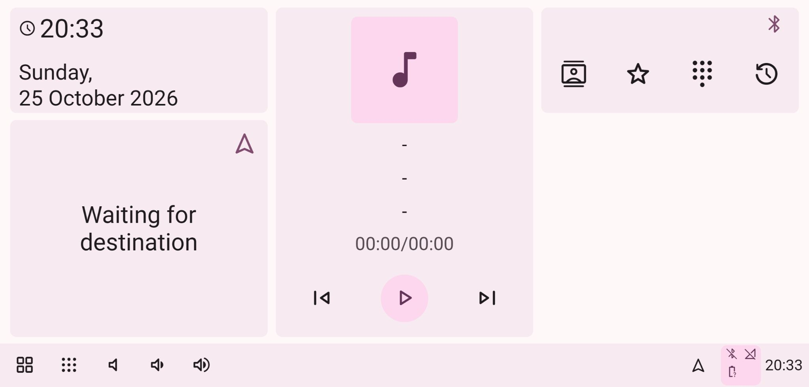
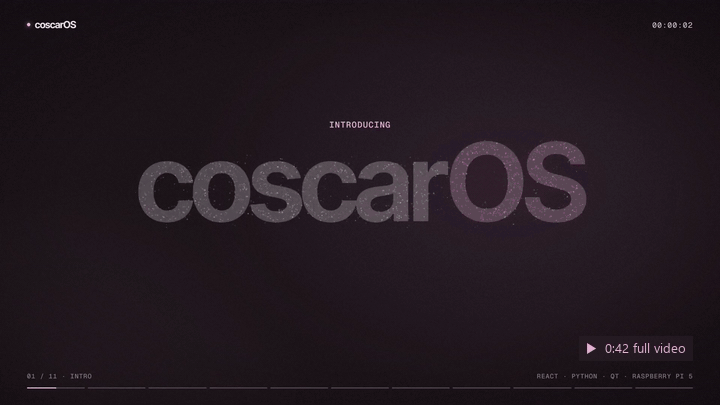
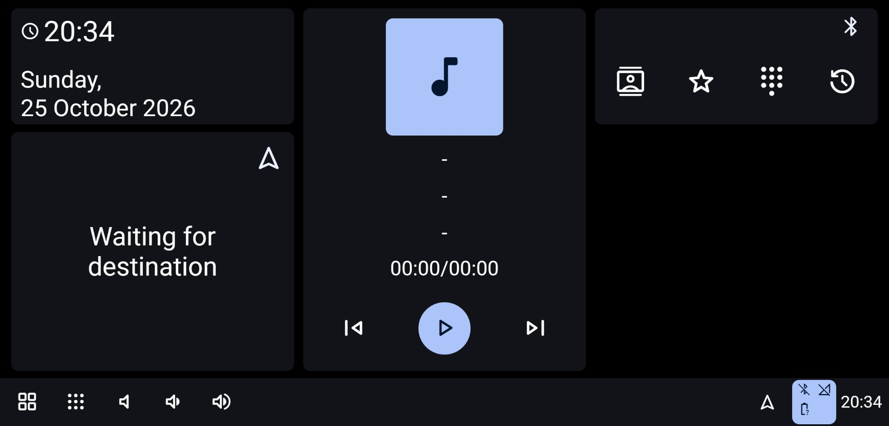
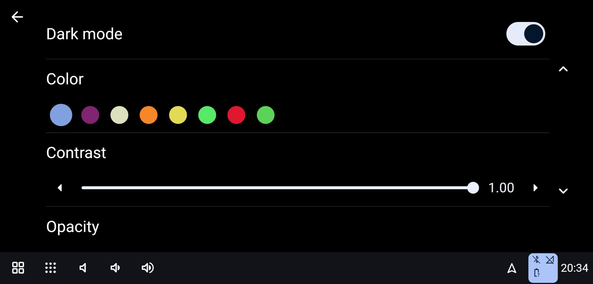
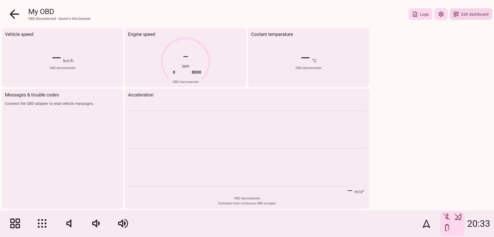
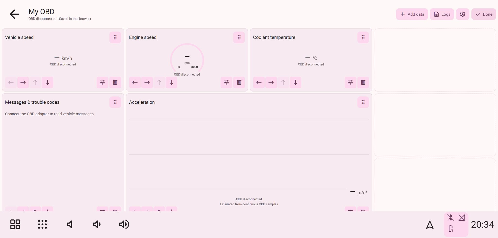
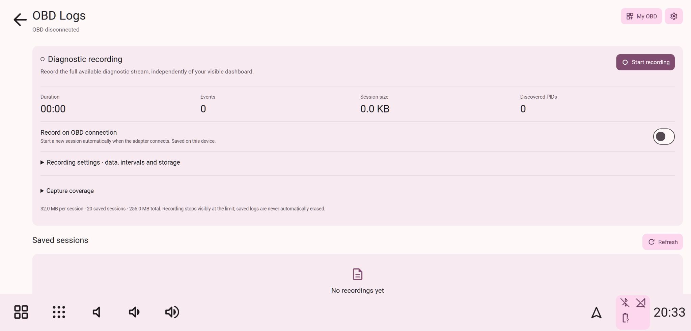
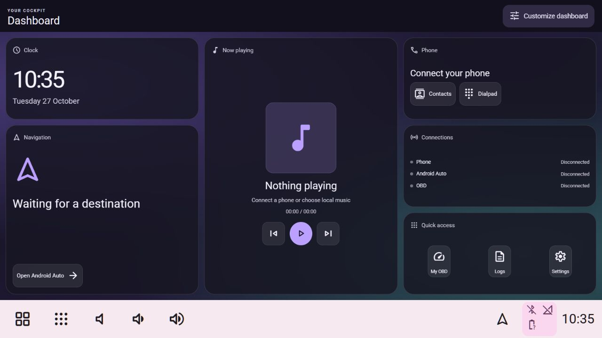
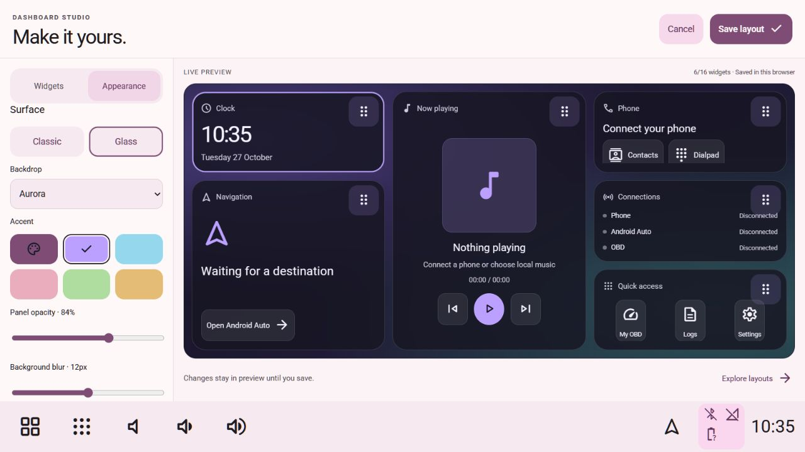
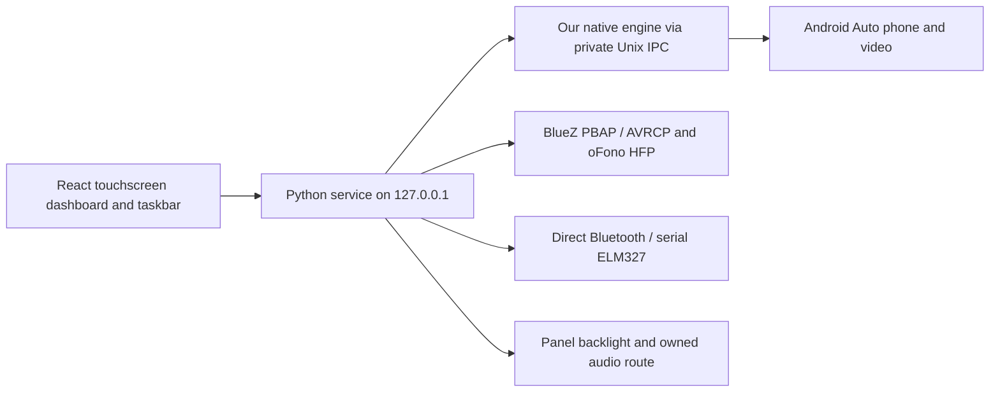

# coscarOS

**Independent Raspberry Pi car software with a configurable touchscreen dashboard.**

React touchscreen UI · Python hardware service · Qt fullscreen host · USB & wireless Android Auto

[](docs/images/dashboard-current.jpg)

**[Install on your Pi](#easy-pi-installation)** · **[Explore the gallery](#screenshot-gallery)** · **[Hardware test results](docs/README_TEST_RESULTS.md)**

### ▶ Watch the intro · 0:42

[](docs/videos/coscaros-intro.mp4)

**[▶ Watch the full video (MP4)](docs/videos/coscaros-intro.mp4)** · A 42-second tour built in code from real app captures (no sound). Open the [demo page](docs/demo/index.html) for the full player, features and gallery; [video source](docs/videos/source/README.md).

**[▶ Full demo with sound · 1:47 (MP4)](docs/videos/coscaros-demo-v2.mp4)** · Real app footage, chapter by chapter: Android Auto settings, themes, Dashboard Studio, My OBD (built-in demo telemetry), recording, Bluetooth and audio, the guided tour, updates and installation.

## Contents

- [First launch and guided introduction](#first-launch-and-guided-introduction)
- [Introduction](#introduction)
- [coscarOS branding and upgrade compatibility](docs/BRANDING.md)
- [Capability status and daily-use roadmap](#capability-status-and-daily-use-roadmap)
- [Screenshot gallery](#screenshot-gallery)
- [What we rebuilt and corrected from Hudiy](#what-we-rebuilt-and-corrected-from-hudiy)
  - [Observing the original](#1-observed-the-original-application)
  - [Rebuilt interface and corrections](#2-rebuilt-the-interface-in-code)
  - [Backend and Pi startup](#3-added-the-real-backend-and-pi-launchers)
  - [Android Auto](#4-integrated-android-auto)
  - [Bluetooth phone services](#5-integrated-bluetooth-phone-services)
  - [Required OBD vehicle data](#6-added-required-obd-vehicle-data-support)
  - [Audio support](#7-added-audio-support)
- [Dashboard Studio, widgets and layout packs](#dashboard-widgets-and-layout-packs)
- [Custom OBD dashboard](docs/CUSTOM_OBD.md)
- [OBD diagnostic logging](docs/OBD_LOGGING.md)
- [OTA software updates](docs/OTA_UPDATES.md)
- [Black startup](docs/BLACK_STARTUP.md)
- [Microphones and audio capture](docs/AUDIO_INPUT.md)
- [Architecture](#architecture)
  - [Repository structure](#repository-structure)
- [Run locally](#run-locally)
- [Easy Pi installation](#easy-pi-installation)
- [Run on the Raspberry Pi](#run-on-the-raspberry-pi)
- [Settings and privacy](#settings-and-privacy)
- [Tests and observed results](#tests-and-observed-results)
  - [Performance and reliability](#performance-and-reliability)
- [Real-Pi README acceptance report](docs/README_TEST_RESULTS.md)
- [Remaining work checklist](#remaining-work)
- [Legal documentation, Austrian/EU review and provenance](LEGAL.md)
- [Clean-room approach and legal basis](#clean-room-approach-and-legal-basis)
- [License and public references](#license-and-public-references)

## Introduction

**coscarOS brings phone projection, a customizable vehicle dashboard and diagnostic recording into one Raspberry Pi touchscreen application.** Keep the taskbar visible beside Android Auto, build your own OBD layout, and choose how connections, recording and updates behave.

- **USB and wireless Android Auto:** native video, touch input and background phone data, with separate automatic connection and automatic opening settings.
- **Your own OBD cockpit:** arrange blocks, original arc/tick gauges, charts and messages; define read-only custom sensors and formulas.
- **Diagnostic recording:** manual or automatic capture, configurable intervals and storage limits, and local CSV/JSONL exports.
- **Touch-first controls:** long-press shortcuts, drag-and-drop layouts, keyboard-free contact filters, configurable themes and responsive screens.
- **A dedicated Pi application:** fullscreen Qt host, black startup, saved preferences and a working return to the desktop.
- **Updates in Settings:** GitHub source updates, isolated preparation, health checks and rollback, with manual or automatic-idle installation.

The React interface, Python hardware service and native receiver run independently of proprietary Hudiy. The native receiver uses a pinned, separately licensed open-source Android Auto protocol library. Bluetooth phone services, ELM327 selection and protected car Wi-Fi are managed by our application.

The project began by observing the owner's Hudiy 1.24 installation and rebuilding its behavior independently. coscarOS is our product name; the [comparison below](#what-we-rebuilt-and-corrected-from-hudiy) records that history. See [branding and upgrade compatibility](docs/BRANDING.md).

Real USB/wireless projection, phonebook synchronization, persistence, installation and managed OTA have been exercised on a Raspberry Pi 5 running 64-bit Raspberry Pi OS Trixie. Vehicle compatibility, extended audible operation and the ignition/power lifecycle still need the hardware checks listed under [remaining work](#remaining-work). CarPlay/Autobox is not implemented. The [acceptance report](docs/README_TEST_RESULTS.md) records the exact scope.

## Capability status and daily-use roadmap

Our goal is a dependable Raspberry Pi infotainment system combining smartphone projection with a configurable vehicle cockpit. The next milestones focus on complete daily-use workflows and repeatable hardware results.

| Capability | Current coscarOS status | Evidence or next milestone |
| --- | --- | --- |
| Raspberry Pi 5 | Tested on a 4 GiB Pi 5, 64-bit Trixie Desktop and a 1280×720 DSI display. | [Recorded device configuration](docs/README_TEST_RESULTS.md); name the exact panel model and complete physical touch acceptance. |
| Android Auto | Real USB and wireless video/input verified, including wireless setup without a preceding USB connection. | [Phone tests](docs/README_TEST_RESULTS.md#phone-display-and-interface); extend reconnect and multi-phone coverage. |
| Navigation and music | Projection and metadata integration exist; audio output uses the native worker and configurable routing. | Verify phone-local playback, spoken directions and output recovery together on actual speakers. |
| Phone calls and microphone | Phonebook/call controls and native microphone selection, gain and mute are implemented. | Complete incoming/outgoing conversation and voice-request capture with a real microphone and speakers. |
| OBD and diagnostics | Standard live readings, custom Mode 01/22 mappings, formulas, layouts and diagnostic recording are implemented. | [Custom sensors](docs/CUSTOM_OBD.md) and [recording scope](docs/OBD_LOGGING.md); powered-vehicle/adapter validation remains open. |
| Custom cockpit | Blocks, charts, messages, original arc/tick gauges and drag/drop layouts; real-Pi layout/reboot persistence checked. | Complete physical finger, long-press and multitouch checks on the mounted display. |
| Installation and updates | Fresh Trixie installation and real GitHub OTA activation, health checks, rollback and reinstallation verified. | Repeat on fresh Bookworm and test controlled network/power interruption recovery. |
| Apple CarPlay | Not implemented; the Autobox menu is not a working CarPlay receiver. | Select the receiver/authentication hardware path, implement it and verify with an iPhone. |
| Ignition and shutdown | Automatic application startup and black boot are implemented. | Add ignition-aware safe shutdown with suitable power hardware and test repeated power cycles. |
| Screenshots | The current main gallery uses actual disconnected app states without generated readings. | [Capture provenance](docs/ASSET_PROVENANCE.md#current-readme-captures--25-october-2026); historical fixture captures remain documented separately. |

Standard live readings currently include engine load, coolant temperature, RPM, speed, throttle and control-module voltage. Custom mappings and diagnostic capture extend this beyond the six dashboard readings, subject to the ECU and adapter's actual support; they do not unlock every manufacturer signal.

**Software and hardware costs:** the source is open source; no coscarOS subscription or paid activation is required. The dashboard/backend are MIT-licensed; the native application, including its linked projection engine, is GPL-3.0-or-later. Hardware is separate: a compatible ELM327 is required for vehicle data, while the separate Bluetooth-to-radio audio receiver is optional. See [licensing](#license-and-public-references).

### Next milestones

- [ ] **P1 — Complete phone audio:** verify phone-local music, navigation speech, voice requests and an authorized incoming/outgoing call on real speakers and a microphone; record routing, echo, volume, mute and unplug/replug results.
- [ ] **P1 — Validate vehicle diagnostics:** record the vehicle model/year/engine, ECU, adapter and protocol; compare standard/custom readings with a reference diagnostic tool, then verify fault messages, recording/export, reconnect and stale-data clearing. Keep unsupported signals explicitly unavailable.
- [ ] **P1 — Prove connection reliability:** repeat at least ten wireless cold starts with USB absent, then USB already attached at boot, cable/range loss, Quit/Resume, late services and phone switching; publish success counts and time to first usable frame.
- [ ] **P1 — Finish the power lifecycle:** choose an ignition-aware supply/shutdown controller, implement its integration and verify clean shutdown, delayed cut-off, restart and preservation of preferences/recordings across repeated cycles.
- [ ] **P2 — Publish performance measurements:** record boot-to-dashboard, reconnect-to-video, frame pacing, input latency, CPU/memory and throttling on a named Pi/display/OS configuration. Run a two-hour projection/audio test with OBD recording; report drops, underruns and recovery. Profile first, optimize the measured bottleneck and repeat the same workload.
- [ ] **P2 — Publish display compatibility:** verify the exact Raspberry Pi Touch Display 2 model/resolution, all required rotations, corner alignment, physical touch/long-press/multitouch, brightness and resume behavior; add the result to a hardware compatibility table.
- [ ] **P2 — Add CarPlay:** choose and document a compatible receiver/authentication route and its required hardware, complete native integration, then test wired/wireless iPhone projection, audio, Siri, taskbar switching and reconnection. [LIVI's documented authentication paths](https://github.com/f-io/LIVI#mfi-authentication) provide a reference; coscarOS currently implements neither of those paths.
- [ ] **P2 — Make releases reproducible:** add fresh-image installation and update/rollback runs to a release checklist, publish tested hardware/version combinations and known issues, and complete the existing distribution/license review before shipping an image or appliance.

The [detailed remaining-work checklist](#remaining-work) tracks the individual acceptance cases. Update this table when a milestone has supporting evidence; implementation and hardware verification are separate steps.

## Screenshot gallery

Fresh captures from the production frontend and its local Python service on **25 October 2026**. These show the application with no phone or vehicle connected. Click an image for the full-size capture.

| 🌙 Dark dashboard | 🎨 Appearance controls |
| --- | --- |
| [](docs/images/dashboard-dark-current.jpg) | [](docs/images/theme-settings-current.jpg) |
| Dashboard cards and persistent taskbar in the dark theme. | Independent light/dark preferences and global accent colors. |

| 🧩 My OBD | ↔️ Layout editor |
| --- | --- |
| [](docs/images/my-obd-current.jpg) | [](docs/images/my-obd-editor-current.jpg) |
| Choose the data and display types for your cockpit. | Reposition and configure tiles using touch or keyboard controls. |

[](docs/images/obd-logs-current.jpg)

**OBD Logs:** recording policy, capture settings, storage limits and saved sessions in one place.

Capture details and earlier assets are recorded in [asset provenance](docs/ASSET_PROVENANCE.md). Hardware results are documented separately in the [Pi acceptance report](docs/README_TEST_RESULTS.md).

## First launch and guided introduction

New profiles receive a 19-section spotlight introduction to the actual dashboard,
shortcuts, customization, phone/Android Auto setup, audio, OBD, logging and updates.
Next/Back and a section picker let you go at your own pace. Skip requires a separate
confirmation; outside taps never dismiss it. Progress resumes after an interruption.
Replay it from **Settings → System → Application → Replay introduction**.

The tour previews pages without pairing devices, placing calls, starting playback
or recording, or installing updates. The browser workflow and progress storage are
tested. Native OTA deployment and startup health passed on the reference Pi;
physical tour interaction and Android Auto foreground/lease acceptance remain open. See the [complete new user guide](docs/NEW_USER_GUIDE.md).

## Dashboard widgets and layout packs

Build your cockpit in **Dashboard Studio**: add, arrange, rename and resize widgets
in a live preview, then save the result. Choose clock, navigation, music, phone,
connection status, shortcuts, diagnostics and vehicle readings with original
gauges or charts. Drag grips, precise move/swap controls and an on-screen title
keyboard keep customization usable through the GUI.

The original dashboard remains the default. **Glass is optional**, with configurable
backdrops, accent, opacity, blur, rounding, spacing and motion. Native layouts use
private, revision-checked device storage; a desktop preview saves in that browser.

| Optional glass dashboard | Dashboard Studio |
| --- | --- |
| [](docs/images/widgets-glass.jpg) | [](docs/images/dashboard-studio.jpg) |

**Extensions → Layouts** provides four bundled layouts plus JSON import/export.
Preview a shared layout before saving it, or choose Original to restore the familiar
interface. An online community download catalog is planned. Read the [widget and
layout-pack guide](docs/DASHBOARD_WIDGETS.md) for controls, storage and verification.

These new captures are from the local production build on 27 October 2026 with
no phone/vehicle attached. This widget revision is ready for local review; native
Pi acceptance and deployment remain open.

## What we rebuilt and corrected from Hudiy

The comparison below uses the **original Hudiy 1.24 installation** as the reference. “Rebuilt” describes behavior we observed and implemented ourselves. “Added/corrected” describes changes to **our recreation**, including issues reported while testing it; it does not claim that the original Hudiy has those bugs.

| Original Hudiy reference | What we rebuilt | What we added or corrected in our version |
| --- | --- | --- |
| Clock, destination, music and phone cards with a bottom taskbar | The dashboard structure, rounded cards, spacing, typography and shortcuts | Responsive layouts, full accent propagation and touch scrolling |
| Category menus, settings rows, switches, sliders and color choices | The navigation hierarchy and familiar control shapes | Consistent Pair screen, one discovery action and shorter radio-output controls |
| Taskbar shortcuts and app navigation | Working navigation between dashboard, menus and players | Long-press pinning/reordering and durable settings across Pi reboots |
| Android Auto projection and its connection/settings menus | USB/Wi-Fi entry points, Resume/Quit and phone projection | Our own open-source-based engine; persistent taskbar or fullscreen choice; separate reconnect and automatic-opening settings |
| Music, contacts, favorites, call history and dialpad screens | Player controls, phonebook views and calling interface | Keyboard-free name filters, configurable refresh intervals and real Bluetooth service adapters |
| OBD Charts, Blocks, Combined and two gauge layouts | Code-rendered telemetry views | Direct read-only Bluetooth ELM327 polling, adapter/channel selection and explicit unavailable/demo states |
| Sound, equalizer and output settings | Sound controls and local-file equalizer/balance | Optional Bluetooth-to-radio routing and our own persistent native projection equalizer/balance |
| Fullscreen Pi application and startup workflow | Our own fullscreen Qt host and graphical-login launcher | Independent runtime ownership and an application Quit path back to the desktop |

The following sections explain the implementation and its limits. The [style specification](style.md) records the visual observations and intentional changes; the [public Hudiy repository](https://github.com/wiboma/hudiy) provides upstream documentation.


### 1. Observed the original application

We controlled the owner's Pi, inspected the running dashboard, menus and settings, and captured reference screens. We recorded geometry, navigation, colors, typography, screen states and behavior. Public Hudiy configuration and API documentation provided the supported integration points. Proprietary implementation code was not used as input.

The raw observations remain in the private development workspace. Captures can contain contacts, phone numbers, nearby Bluetooth identifiers and map locations, so they are not included in this public repository. This repository contains our code, the style specification, the backend rules and a summary of verification. See [clean-room policy](CLEAN_ROOM_POLICY.md).

### 2. Rebuilt the interface in code

We recreated the clock/navigation/music/phone dashboard, application menus, settings, music players, dialpad and five OBD views. Screenshots are reference evidence; they are not backgrounds used to fake a working application.

We added and corrected:

- Responsive landscape, narrow and portrait layouts, with content scrolling above the taskbar.
- Independent light/dark appearance preferences, with the selected accent applied across menus, controls and gauges.
- Touch scrolling that does not select interface text; moving a finger cancels a pending long press.
- Long-press customization, pinning shortcuts, and changing taskbar, application-tile and dashboard order.
- Durable Pi layout storage and synchronization between the dashboard and the taskbar web views.
- Separate configurable music and contact refresh intervals.
- Contact name filters: **All, A–F, G–L, M–R, S–Z and #** for other names/numbers. These replace the search field that required a keyboard.
- A consistent Pair menu with one discovery action, a pairing action for each discovered device, and our own pairing-code/PIN confirmation dialog.
- Concise optional radio-output controls without accessory-specific instructions.
- Code-rendered gauges with bundled fonts, theme colors and indicators that follow finite readings. Missing data stays unavailable; Demo is explicitly labeled.
- A working application Quit path that returns to the desktop while preserving the saved settings and next-boot startup.

The visual rules are in [style.md](style.md).

### 3. Added the real backend and Pi launchers

The Python service provides a local HTTP API, validates actions, maintains bounded live data and saves supported preferences privately. The native Qt 6.4+ application owns two web views (content and taskbar), an Android Auto video surface, the protocol session, USB transport, car Wi-Fi listener, audio playback and microphone capture.

The launcher prevents a second application owner. The native process starts and owns the Python service and uses a private user-only Unix socket for commands and live events. Quit closes our own application and its backend. The reversible labwc installer selects our launcher after graphical login and retains startup/configuration backups.

Ignition was assumed to supply power to the Pi. We did **not** implement an ignition GPIO input, a controlled power-cut circuit or a shutdown controller.

### 4. Integrated Android Auto

Our own native executable links `prodigy-oaa-protocol`, pinned to a documented open-source revision. It negotiates an Android Auto session and handles H.264 video, PCM media/speech/system audio, touch/multitouch, microphone input and media/navigation status channels. USB accessory negotiation is implemented in our bounded libusb transport. Wireless setup uses our own BlueZ profile and the operator's protected NetworkManager car hotspot.

- The video surface sits above our taskbar, with Dashboard/Applications switching back to our web interface while the session stays connected.
- The taskbar setting changes the advertised video/touch viewport and reconnects the session; the application stays running.
- **Settings → Projections → Android Auto → Connect Android Auto automatically** saves automatic versus manual USB/Wi-Fi connection. **Open Android Auto automatically** separately controls foreground opening; enable both for unattended opening. Turning connection off leaves an active session running. The native connection policy has passed its Pi build/tests and the documented wireless acceptance run; remaining phone permutations are in the [test checklist](#direct-wireless-connection-and-automatic-connection).
- Per-phone Bluetooth reconnect is separate. With the master switch and Car Wi-Fi on, one recognized paired phone is selected by default unless its Bluetooth switch was explicitly turned off; several paired phones require selection. Phone detection also uses hands-free services/device class, so contact sharing is optional for reconnection. These choices are saved privately alongside Connections preferences.
- Music and navigation refresh defaults to **1 second**, configurable from **1–60 seconds** in Music settings. Saved custom intervals are preserved. Five-second connection checks and event-driven phone metadata feed the backend. Wireless handoff retries are limited to one every 30 seconds, wait during an active/starting session and never open the screen themselves; the existing music/contact refresh settings remain configurable.
- Day/Night is sent through the Android Auto sensor channel. Physical brightness still writes the real panel backlight.
- Quit stops connection admission until manual USB/Wi-Fi/Resume. USB and Wi-Fi select their respective transport. USB pauses the competing wireless bootstrap; its reconnect targets only one uniquely identified Android accessory, runs outside the UI thread and has a 15-second cooldown. Wired Quit/Resume has been checked without unplugging the cable. Resume can retrigger the owned wireless handshake.
- The audio-input protocol service remains present without a physical microphone. Actual capture requests fail explicitly when no supported input exists; no fabricated microphone audio is sent. Public status separates decoded video readiness from protocol connection and reports microphone availability.
- Pairing confirmations are handled in our own UI; wireless credentials are never returned by the HTTP API or written to logs.

The executable builds on the actual Bookworm Pi 5. [docs/STANDALONE.md](docs/STANDALONE.md) records genuine USB and wireless video on our engine separately from historical tests of the old bridge. Physical multitouch, microphone audio and guided navigation still need hardware verification.

### 5. Integrated Bluetooth phone services

Contacts and recent calls come from **BlueZ PBAP**, independently of USB Android Auto. The phone must already be paired and permit contact sharing. The reference phone supplied 94 contacts, 100 recent-call entries and no favorites. We fixed a stale OBEX-session bug so the service can recreate its own missing session without taking over another client's session.

Contact downloads default to **60 seconds**, configurable from **5–3600 seconds**. The interface checks completed results every five seconds and also provides manual Refresh. Filtering preserves the phone's order and groups accented names without keyboard entry.

Calling uses the existing **oFono HFP** service. Selecting a contact opens the dialpad; placing a call requires number confirmation. Available controls support Dial, incoming Answer, single-call Hangup and microphone mute. One authorized real outgoing test reached dialing/alerting and was hung up; no active call remained. Conversation audio, an incoming call and microphone behavior in a live conversation remain unverified.

Bluetooth music uses reported metadata and the connected phone's addressed **AVRCP** player. The dashboard follows the active Android Auto or Bluetooth source, while an explicitly selected local file retains ownership of its player. A short authorized Bluetooth Play/Pause check reported playing and then paused. Bluetooth cover art and audible output still depend on the phone/player/stack and have not been verified end to end.

The Connections menu provides paired-device Connect/Disconnect and opt-in automatic reconnect. Retries are limited to once per device every 30 seconds. Android Auto settings expose the same choice for phones advertising PBAP. Disconnect and unpairing have confirmations; our own agent handles numeric/PIN approval. An explicitly selected successful pairing is marked trusted. The automatic reconnect worker neither pairs devices nor grants trust.

### 6. Added required OBD vehicle data support

**Bluetooth ELM327 vehicle data is required for this project. The separate Bluetooth radio audio receiver is optional.**

We added native Bluetooth Serial Port adapter selection, RFCOMM channel controls (1–30), serial/USB presets and read-only Mode 01 polling. COM2 is a serial port name; it is not the same thing as RFCOMM channel 2. BLE-only adapters are currently unsupported.

Our backend opens the selected Bluetooth adapter directly through RFCOMM and starts supported reads. Failed connections retry at most every 30 seconds. Disconnect clears old readings/history. Manual Stop suppresses monitoring for the current service session, and selecting serial/USB takes precedence. A manual Bluetooth read keeps the required automatic reconnect monitor enabled.

Supported values are engine load, coolant temperature, RPM, speed, throttle and control-module voltage. Views include OBD Charts, OBD Blocks, Combined and two gauge layouts. A loopback simulator is supported for development; simulated data does not count as a real vehicle test.

**My OBD** adds a personal drag-and-drop dashboard: choose data, positions, tile sizes, blocks, gauges or charts. Define up to eight custom Mode 01/22 sensor mappings with byte formulas and a touchscreen keyboard. Add stored trouble codes, sampled acceleration, 0–100 statistics and estimated range/consumption with explicitly configured fuel inputs. Definitions and layout save privately on the Pi. See the [custom OBD guide](docs/CUSTOM_OBD.md) for setup, limits and verification.

**OBD Logs** records independently of the visible page, with configurable manual/automatic recording, data categories, sample/scan intervals and storage limits. It captures advertised diagnostics, custom mappings, raw replies and connection errors, with recent-event review and local CSV/JSONL export. See the [logging guide](docs/OBD_LOGGING.md) for capture scope, storage and verification limits.

The reference adapter was paired and its cached Serial Port advertisement matched the configured RFCOMM channel 2, but it was unreachable during verification. **Live vehicle readings have not yet been verified.** The service sends only its fixed initialization/read-only sensor allowlist; it does not offer arbitrary CAN/ECU commands or fault clearing.

### 7. Added audio support

Local audio supports file selection, playback, seeking and playlist navigation. Its 15-band Web Audio equalizer and stereo balance affect that selected local file, with offline signal checks for the audio graph.

Sound can optionally save a separate paired Bluetooth A2DP receiver for the car radio. The Pi remains the middleman: our worker routes playback belonging to our native process or the single connected paired phone. It checks every five seconds, waits during calls and verifies the changed route on a later poll. It can select the receiver as the default output; it does not move unrelated active streams. Selecting a receiver does not start playback or pair it. No proprietary equalizer/echo chain is required.

No radio receiver was selected for the final checks. Audible music, navigation and calls through such a receiver remain unverified. The native projection output now processes the same 15-band equalizer curve and stereo balance. Media/speech/system PCM use owned processors with peak bounds; balance leaves mono speech intact. Settings save privately, synchronize across our two web views, and reload on app restart. Flat is signal-identical in tests. Our practical preset curves replace the previous placeholder curves; they are not claimed to match proprietary Hudiy preset values. Multichannel fade/subwoofer hardware, Bluetooth AVRCP DSP, FM tuner audio and CarPlay/Autobox integration remain incomplete.

Native projection audio now feeds its sinks from a dedicated worker, separate from GUI/video decoding. A silent-sink test with repeated 120 ms GUI stalls reproduced 391,808 dropped bytes in the old implementation; the worker delivered every submitted byte with no drops and an empty final queue. The reference Pi was restarted into this revision and wireless video/audio counters recovered with our taskbar intact. These are transport/buffering checks, not audible car-radio evidence. See [audio verification](docs/STANDALONE.md#dedicated-audio-worker--10-october-2026).

## Architecture



### Repository structure

The tree expands the tracked source and documentation. Test suites and gallery images are grouped by filename pattern. Generated builds, downloaded dependencies and private device data are excluded from this source map. The native executable and some internal IDs retain legacy names for [upgrade compatibility](docs/BRANDING.md).

<details open>
<summary>coscarOS source tree</summary>

```text
coscarOS/
├── docs/  # Setup, integration, verification and legal guides
│   ├── images/  # Public screenshots using synthetic/demo data
│   │   └── *.jpg  # Public gallery captures
│   ├── ASSET_PROVENANCE.md
│   ├── AUDIO_INPUT.md
│   ├── backend-rules.md
│   ├── BLACK_STARTUP.md
│   ├── BRANDING.md
│   ├── CUSTOM_OBD.md
│   ├── HOTSPOT_SETUP.md
│   ├── HUDIY_DEPENDENCIES.md
│   ├── INSTALL.md
│   ├── LEGAL_REVIEW_AT_EU.md
│   ├── OBD_CAPTURE.md
│   ├── OBD_CAPTURE_VERIFICATION.md
│   ├── OBD_LOGGING.md
│   ├── README_TEST_RESULTS.md
│   ├── OTA_UPDATES.md
│   ├── STANDALONE.md
│   └── VERIFICATION.md
├── implementation/  # Application source and build definitions
│   ├── dashboard/  # React touchscreen frontend
│   │   ├── .openai/
│   │   │   └── hosting.json  # Optional hosting metadata
│   │   ├── public/
│   │   │   └── THIRD_PARTY_NOTICES.txt  # Complete browser library/font licenses
│   │   ├── qa/
│   │   │   └── audio-dsp-check.html  # Offline browser audio-graph check
│   │   ├── scripts/
│   │   │   ├── licenses.mjs  # Generate notices from locked installed packages
│   │   │   └── prepare-sites-build.mjs  # Optional static-hosting build packaging
│   │   ├── src/  # Screens, components and browser-side behavior
│   │   │   ├── App.jsx  # Dashboard, navigation, settings and taskbar
│   │   │   ├── DashboardStudio.jsx  # Widget renderer, editor and layout packs
│   │   │   ├── dashboardWidgets.mjs  # Schema, placement, presets and pack validation
│   │   │   ├── useDashboardWidgets.js  # Revision-aware device/browser persistence
│   │   │   ├── Introduction.jsx    # First-launch spotlight guide and deliberate skip
│   │   │   ├── onboarding.mjs      # Guide sections and bounded progress model
│   │   │   ├── useOnboarding.js    # Device/browser progress and replay lifecycle
│   │   │   ├── introduction.css    # Themed accessible spotlight surfaces
│   │   │   ├── dashboardStudio.css  # Classic/glass surfaces and responsive editor
│   │   │   ├── audio.js
│   │   │   ├── AudioInput.jsx  # Microphone selection, gain and mute
│   │   │   ├── audioPresets.mjs
│   │   │   ├── BluetoothView.jsx
│   │   │   ├── branding.mjs  # coscarOS labels with compatible stored IDs
│   │   │   ├── CallButton.jsx
│   │   │   ├── catalog.js  # Menu definitions and preferences
│   │   │   ├── contactFilters.js
│   │   │   ├── CustomizeMenu.jsx
│   │   │   ├── customOBD.css
│   │   │   ├── CustomOBD.jsx  # Custom dashboard editor and tile layout
│   │   │   ├── customOBD.mjs  # Custom dashboard configuration helpers
│   │   │   ├── DisplayBrightness.jsx
│   │   │   ├── layout.js  # Persistent shortcuts and ordering
│   │   │   ├── LicenseNotices.jsx  # In-app dependency/font license viewer
│   │   │   ├── main.jsx  # React entry point
│   │   │   ├── media.mjs
│   │   │   ├── notifications.mjs
│   │   │   ├── obdLogs.css
│   │   │   ├── OBDLogs.jsx  # Diagnostic recording and export controls
│   │   │   ├── OBDSettings.jsx
│   │   │   ├── PhonebookView.jsx  # Contacts, favorites and call history
│   │   │   ├── PhoneReconnect.jsx
│   │   │   ├── RadioOutput.jsx
│   │   │   ├── softwareUpdates.css
│   │   │   ├── SoftwareUpdates.jsx  # OTA status and update preferences
│   │   │   ├── startup.mjs  # Startup readiness acknowledgement
│   │   │   ├── styles.css  # Shared responsive styling
│   │   │   ├── Telemetry.jsx  # Standard OBD views and gauge rendering
│   │   │   ├── theme.js
│   │   │   ├── UpdateInterval.jsx
│   │   │   ├── useDragScroll.js
│   │   │   ├── useLongPress.js
│   │   │   └── WirelessSettings.jsx
│   │   ├── tests/  # Frontend, startup, license and hosting regressions
│   │   │   └── *.test.mjs  # Frontend regression suites
│   │   ├── worker/
│   │   │   └── index.js  # Static frontend host; no Pi device services
│   │   ├── .npmrc
│   │   ├── AGENTS.md
│   │   ├── index.html
│   │   ├── package-lock.json  # Exact npm dependency versions
│   │   ├── package.json  # Frontend commands and dependencies
│   │   └── vite.config.mjs  # Development proxy and production build
│   ├── launcher/  # Pi installation, session lifecycle and recovery
│   │   ├── install_autostart.py  # Reversible user-session startup setup
│   │   ├── install_black_boot.py  # Reversible quiet boot/session setup
│   │   ├── install_pi.py  # Guided dependency/build/install orchestration
│   │   ├── install_pi_system.py  # Bounded privileged OS setup
│   │   ├── launcher.py  # Start and own the independent runtime
│   │   ├── provision_hotspot.py  # Prepare protected, initially inactive car hotspot
│   │   ├── session.py  # Car-session or ordinary-desktop selection
│   │   └── update_supervisor.py  # Select releases and recover failed startup
│   ├── native/  # GPL fullscreen Qt host and Android Auto integration
│   │   ├── audio_dsp.hpp  # Projection equalizer and balance processing
│   │   ├── audio_output.hpp  # Bounded audio worker and sink feeding
│   │   ├── CMakeLists.txt  # Native targets and pinned protocol dependency
│   │   ├── connection_policy.hpp  # Android Auto connection admission
│   │   ├── LICENSE  # GPL-3.0-or-later license
│   │   ├── main.cpp  # Web views, projection, audio, input and IPC
│   │   ├── microphone_pcm.hpp  # Microphone PCM gain/mute
│   │   ├── notice_overlay.hpp  # Notifications above projection
│   │   ├── startup_gate.hpp  # Black cover until web views are ready
│   │   ├── stress_audio_output.cpp  # Opt-in silent-sink stress probe
│   │   ├── test_*.cpp  # Native CTest signal/policy/startup regressions
│   │   ├── THIRD_PARTY.md  # Adaptations, source pins and distribution obligations
│   │   ├── usb_transport.cpp  # Android USB accessory transport
│   │   └── usb_transport.hpp  # USB transport interface
│   ├── service/  # Python loopback API and device integrations
│   │   ├── audio_route_support.py
│   │   ├── audio_settings.py  # Native EQ/balance preferences
│   │   ├── bluetooth_devices.py  # Discovery, pairing and reconnection settings
│   │   ├── bluez_agent.py  # Bluetooth pairing confirmation/PIN agent
│   │   ├── calls.py  # oFono call integration
│   │   ├── custom_obd.py  # Custom PID definitions and formula validation
│   │   ├── diagnostic_sweep.py  # Paced diagnostic discovery and capture
│   │   ├── display.py  # Physical backlight control
│   │   ├── driving_stats.py  # Derived driving statistics
│   │   ├── elm_frames.py  # ECU response and multi-frame parsing
│   │   ├── independent_audio_route.py  # Optional radio output routing
│   │   ├── independent_obd.py  # Direct Bluetooth/serial adapter ownership
│   │   ├── independent_wireless.py  # Owned car hotspot configuration
│   │   ├── input_settings.py  # Microphone preference validation/persistence
│   │   ├── layout.py  # Durable shared UI layout storage
│   │   ├── live_media.py  # Addressed Bluetooth media metadata
│   │   ├── obd.py  # Allowlisted live ELM327 polling
│   │   ├── obd_logging.py  # Private sessions, recording limits and exports
│   │   ├── ota_state.py  # Managed release state and rollback metadata
│   │   ├── phonebook.py  # Phonebook synchronization
│   │   ├── requirements.txt  # Python dependency requirements
│   │   ├── runtime_support.py  # Private settings, routes and wireless handshake
│   │   ├── server.py  # HTTP API and built-frontend serving
│   │   ├── dashboard_widgets.py  # Validated widget storage and layout export
│   │   ├── software_update.py  # Fixed GitHub source, preparation and parked activation
│   │   ├── standalone_projection.py  # Owned native IPC and projection status
│   │   ├── test_*.py  # Backend, API, transport and installer regressions
│   │   ├── updates.py  # Music/contact refresh intervals
│   │   └── usb_recovery.py
│   └── OTA_PROTOCOL  # Managed release protocol version
├── CLEAN_ROOM_POLICY.md  # Observation and implementation policy
├── design-qa.md  # Design verification notes
├── install.sh  # One-line Raspberry Pi installer entry point
├── LEGAL.md  # Legal documentation and release-review index
├── LICENSE  # Dashboard/backend MIT license
├── README.md  # Introduction, architecture, setup and remaining work
├── SECURITY.md  # Security boundaries and reporting
└── style.md  # Themes, layout, gauges and visual conventions
```

</details>

Start with [`App.jsx`](implementation/dashboard/src/App.jsx) for UI navigation, [`server.py`](implementation/service/server.py) for API routes, [`main.cpp`](implementation/native/main.cpp) for the fullscreen receiver, and [`launcher.py`](implementation/launcher/launcher.py) for runtime ownership. Device and persistence boundaries are in [backend rules](docs/backend-rules.md); hardware acceptance and historical results are in [verification](docs/VERIFICATION.md). [LEGAL.md](LEGAL.md) indexes licensing, provenance and the Austrian/EU assessment.

## Run locally

Use Python 3.10+ and a Node version supported by the locked frontend dependencies (Node **20.19+ in the 20.x line**, or **22.12+**). npm is required. Python serial support uses the pinned `pyserial` requirement; native phone/projection features are Pi-only.

From the repository root:

```sh
python -m pip install -r implementation/service/requirements.txt
cd implementation/dashboard
npm ci
npm run build
cd ../..
python implementation/service/server.py
```

Open [http://127.0.0.1:8766/](http://127.0.0.1:8766/). The backend serves the built dashboard on loopback. Without the Pi projection host, live phone/hardware controls report unavailable instead of inventing data.

For frontend development, keep the backend running and use a second terminal:

```sh
cd implementation/dashboard
npm run dev -- --host 127.0.0.1 --port 4173 --strictPort
```

Open [http://127.0.0.1:4173/](http://127.0.0.1:4173/). Vite proxies `/api` to the local service on port 8766. Do not start a second backend on a port already occupied by an SSH tunnel or another service.

## Easy Pi installation

Choose **Raspberry Pi OS (64-bit) with Desktop** in Raspberry Pi Imager. Check `dpkg --print-architecture` on the Pi: it must return `arm64`. An `armhf` result means a 32-bit image, even if `uname -m` says `aarch64`; reflash with the 64-bit desktop image before installing. See [OS-image selection](docs/INSTALL.md#choose-and-check-the-os-image).

On **64-bit Raspberry Pi OS Desktop (Bookworm or Trixie)**, check your screen orientation before installing. For the usual car dashboard, the image should be upright in **landscape (horizontal)** orientation. A freshly flashed Pi may use portrait or a sideways orientation depending on the display and its mounting. Rotate it only if needed; an already upright horizontal screen can skip this step. The installer does not rotate the display automatically.

<details>
<summary>Optional: rotate the screen and check touch input (skip if already correct)</summary>

1. On the Raspberry Pi desktop, open **Preferences → Control Centre → Screens**. Older images call this **Preferences → Screen Configuration**.
2. Right-click your display rectangle, then choose **Orientation**. Select the actual car display, such as `DSI-1` or an HDMI output.
3. Try **Left** or **Right** for a quarter-turn, or **Inverted** if upside down. Choose the option that makes the image upright in its physical mounting; **Normal** is display-dependent.
4. Apply and confirm the usable result. Tap the corners to check that touch follows the displayed image; if available, use **Touchscreen** to assign the touch device to that display.
5. Reboot and check again before installation. Check once more after coscarOS starts in its dedicated car session. If it is already installed, **Quit** returns to desktop controls.

See the [full orientation and recovery guide](docs/INSTALL.md#optional-screen-orientation-before-installing) and Raspberry Pi's [display orientation instructions](https://www.raspberrypi.com/documentation/accessories/touch-display-2.html#change-display-orientation).

</details>

Then open a terminal as your ordinary desktop user:

```sh
bash -o pipefail -c 'curl -fsSL https://raw.githubusercontent.com/desquerteur/coscarOS/main/install.sh | bash'
```

The guided installer shows its plan, installs OS dependencies, checks/downloads a private Node runtime, builds/tests our frontend and native receiver, configures Bluetooth/audio/device access, selects startup and prepares an inactive protected hotspot. Default setup enables desktop autologin; `--no-autologin` preserves login authentication. It does not reboot or switch Wi-Fi automatically. See [installation, options and recovery](docs/INSTALL.md). The 25 October app reinstall found and repaired confirmation/session startup bugs locally; the repaired installation now boots automatically and retains user data. The published one-liner also passed on that reference Pi. See [the exact installation test results](docs/INSTALL_VERIFICATION.md). A freshly flashed 64-bit Trixie desktop subsequently passed installation, first launch, saved settings, landscape persistence and automatic boot. Fresh Bookworm, powered-vehicle and audible hardware acceptance remain open. See [the real-Pi README test report](docs/README_TEST_RESULTS.md) for the later phone and OTA checks.

## Run on the Raspberry Pi

Build the frontend first, then install the native build/runtime dependencies:

```sh
sudo apt install build-essential cmake pkg-config qt6-base-dev qt6-wayland qt6-multimedia-dev qt6-webengine-dev qt6-connectivity-dev \
  libprotobuf-dev protobuf-compiler libssl-dev libusb-1.0-0-dev libavcodec-dev libavutil-dev libswscale-dev \
  python3-serial python3-dbus python3-gi bluez bluez-obexd network-manager \
  ofono pipewire pipewire-pulse pulseaudio-utils wireplumber libspa-0.2-bluetooth dbus-user-session
cmake -S implementation/native -B implementation/native/build -DCMAKE_BUILD_TYPE=Release
cmake --build implementation/native/build -j3
python3 implementation/launcher/launcher.py
```

CMake fetches the pinned protocol source and its exact protobuf submodule. The normal launcher requires this binary and refuses an already occupied backend port; it does not silently fall back to Hudiy. Run in the logged-in Wayland graphical session. **Ctrl+Alt+Shift+Q** and the application's **Quit** exit our window and backend.

BlueZ/PBAP, oFono HFP and PipeWire are standard system services. The existing calling/audio setup on the reference Pi is reused; a fresh device still needs those services configured. Our Bluetooth ELM327 worker owns its own RFCOMM socket and polls only allowlisted read-only sensor PIDs. OBD is required; the separate A2DP radio receiver remains optional.

Wireless Android Auto needs a protected 5 GHz NetworkManager AP named `hudiy-recreation-car`, with a private `~/.local/share/hudiy-recreation/wireless.json` describing its SSID/key and fixed gateway `192.168.12.1`. The reference Pi migration cloned the owner's existing AP profile and copied only Wi-Fi/OBD preferences into our private files; subsequent runtime operation does not read the old Hudiy configuration. Fresh protected hotspot preparation is available through `python3 implementation/launcher/provision_hotspot.py` (read-only check) and `--apply` (create inactive profile). Run as the desktop user with our app quit for first-time setup, then start our app and enable Car Wi-Fi. See [hotspot setup and verified limits](docs/HOTSPOT_SETUP.md). Complete clean-image provisioning remains unverified. Do not commit credentials. Initial remote network setup must preserve Ethernet or another recovery connection.

For boot/login startup:

```sh
python3 implementation/launcher/install_autostart.py
python3 implementation/launcher/install_autostart.py --apply
```

The first command prints the exact changes. Applying retains timestamped backups, replaces the managed recreation startup block, disables the exact previous Hudiy startup line if present and adds a labwc rule for our own application. Graphical autologin is assumed. Ignition/power-loss shutdown remains separate hardware work.

The official Hudiy host/API/configuration bridge has been removed from production source. `HUDIY_PROJECTION_HOST` no longer enables an alternative runtime. The normal launcher runs only our native application; desktop preview keeps Pi controls unavailable.

My OBD also uses the original arc/tick gauges with animated drag/drop and a compact, full-area grid. [View the current layout](docs/images/my-obd-current.jpg).


## Black startup

The updated installer and native runtime implement a quiet black boot/car session and keep the dashboard covered until both web views are painted. **Settings → System → Appearance → Black screen during startup** selects the behavior for the next start. Quit/recovery can return to the saved desktop. The reference Pi passed automatic startup, and the owner observed no desktop or white-page flashes during reboot. A recorded full power-on sequence and failure/recovery permutations remain open; see [the Pi acceptance report](docs/README_TEST_RESULTS.md) and [reinstall test](docs/INSTALL_VERIFICATION.md). See [setup, recovery and acceptance](docs/BLACK_STARTUP.md).


## OTA software updates

**Settings → System → Software updates** adds selectable notify/manual or automatic-idle updates from this project's GitHub `main`. Check frequency, notifications, background preparation during Android Auto, metered routes and retained versions are configurable. Builds/tests run in a separate managed copy; activation restarts the app and verifies startup with automatic rollback. Ethernet can supply Internet while wireless Android Auto uses Wi-Fi; an existing free Wi-Fi Internet route is supported too. Network profiles remain unchanged.

Install this OTA-capable revision once before using the updater. OS/package or incompatible bootstrap changes still use the normal installer. See the [OTA guide](docs/OTA_UPDATES.md) for initial deployment, source trust, parked/idle conditions and recovery. Real Pi preparation, activation, health confirmation, rollback, reinstallation and managed startup have passed. The active-call interlock was also exercised. Automatic activation using fresh stationary vehicle readings and interruption recovery remain in the [OTA acceptance checklist](docs/OTA_VERIFICATION.md).

## Settings and privacy

To silence dashboard popups, open **Settings → System → Notifications** and turn
**Enable popup notifications** off. This includes volume, input, track, general
messages and update notices. **General messages** can also be disabled separately;
individual category choices are retained. These choices persist in the browser
or the Pi application's shared web profile. Confirmation dialogs and page status
are unaffected.

In the independent Pi application, supported preferences are stored under `~/.local/share/hudiy-recreation/`, including layout, refresh intervals, projection options, brightness, Bluetooth reconnect selection and optional radio output. Saves are atomic/private on Linux; durable layout/settings saves flush before acknowledgement. The standalone browser preview uses local browser preferences for appearance/layout.

Phonebook and current-call data stay in bounded memory; temporary PBAP transfers are deleted and caches clear when the phone disconnects. Credentials, contact exports, raw captures, generated builds, dependencies, local configs and research data are excluded from Git.

The backend binds to **127.0.0.1** and is designed for a local application, not an internet service. It checks Host/origin, limits JSON action bodies to 4096 bytes and validates fixed actions/device ownership. No external Firebase/Supabase rules are involved. Read the full [backend rules](docs/backend-rules.md) and [security notes](SECURITY.md) before changing those boundaries.

## Tests and observed results

The latest [Pi acceptance report](docs/README_TEST_RESULTS.md) records the following results on the independent runtime:

| Area | Observed result |
| --- | --- |
| Automated checks on the Pi | 259 backend tests, 35 frontend/packaging tests and six native CTests passed during OTA preparation. |
| Phone projection | Real USB and wireless decoded video, input, taskbar switching and Quit/Resume; wireless startup without a preceding USB session. |
| Installation and startup | Fresh 64-bit Trixie desktop installation, automatic launch, retained orientation and preferences; the owner observed no boot flashes. |
| OTA and recovery | Real GitHub release preparation/activation, health confirmation, rollback and reinstallation; managed release selected after reboot. |
| Saved settings | All seven saved-preference hashes matched through the checked update; taskbar and custom OBD layouts persisted. |
| Touch interface | Remote pointer drag and wheel scrolling, theme propagation, hidden scrollbars and keyboard-free contact filtering checked. Physical finger/multitouch acceptance remains open. |
| Vehicle and audio hardware | Powered-vehicle OBD and extended audible media/navigation/conversation tests remain open. |

See [installation evidence](docs/INSTALL_VERIFICATION.md), [OTA evidence](docs/OTA_VERIFICATION.md), [standalone receiver evidence](docs/STANDALONE.md) and [earlier verification history](docs/VERIFICATION.md) for revisions, methods and limits.

Run the automated checks from the repository root:

```sh
python -m unittest discover -s implementation/service -p 'test_*.py'
cd implementation/dashboard
npm ci
npm run build
node --test tests/*.test.mjs
npm audit --omit=dev --audit-level=high
```

### Performance and reliability

The native audio worker keeps delivery outside the UI thread and uses bounded queues. A Pi stress check reproduced overflow in the earlier path; the worker delivered every submitted byte to a temporary silent sink with no dropped or queued bytes. This checks queue behavior during a UI stall; audible endurance remains a separate hardware test. Details are in the [acceptance report](docs/README_TEST_RESULTS.md).

Startup time, projection latency, frame pacing and sustained CPU/memory use still need a reproducible Pi baseline. They are explicit [remaining tasks](#performance-acceptance), rather than claims of superiority over another project.

## Remaining work

The [25 October real-Pi acceptance report](docs/README_TEST_RESULTS.md) maps the
README checks to device evidence and remaining limits. Checked items below are
scoped results, not a declaration that every integration is finished. The gallery
illustrates the interface; hardware acceptance is recorded below.

### Interface and saved configuration

- [x] Build the current native runtime and pass all six CTests on the Pi, including notification/startup/connection-policy checks.
- [x] Display a real native volume popup above Android Auto; verify pointer input still reaches the projected app launcher.
- [x] Verify accent and light/dark changes across the dashboard/taskbar controls and native popup; restore the owner's theme.
- [x] Hide scrollbar chrome across all application views and nested panels; verify wheel and drag scrolling on the updated real Pi, plus keyboard and nested-view scrolling in the browser.
- [x] Reorder a taskbar shortcut through its context menu and drag a My OBD tile on the real Pi; verify both saved configurations survive reboot.
- [x] Verify changed music/contact refresh intervals and input gain/mute settings survive reboot.
- [x] Restore temporary acceptance layouts, contact/input/opening settings after power-on; apply the owner’s subsequent one-second music-refresh request.
- [ ] Verify physical finger long-press, scrolling, popup pass-through and multitouch; remote mouse input is not a physical touch test.

### Black startup acceptance

- [x] Build/test the startup cover and install reversible quiet-boot/car-session configuration.
- [x] Boot the managed OTA release from the dedicated car session, reach both web-view readiness gates and retain saved settings.
- [x] Normal Quit stops the owned app/backend/background and starts one ordinary desktop panel and file manager.
- [x] Owner observed the actual display during the reboot and reported no flashes. This is an eyewitness check, not a recorded boot video.
- [ ] Record the complete physical power-on sequence and repeat on fresh Bookworm, including slow/failed loads, Retry, desktop recovery and restore. See [the detailed checklist](docs/BLACK_STARTUP.md#verification-still-needed-on-the-pi).

### Legal review and distribution

- [ ] Complete independent review of GUI expression, dependency distribution and the coscarOS name before a release.
- [x] Package font/library notices and provide an in-app About viewer with an artifact regression check.
- [ ] Assess distinctive copied interface arrangements and original terms/entitlement, and complete native binary/image licensing before distributing binaries or appliances. An Artcraft comparison is not legal clearance.

### Microphones and audio capture

- [x] Add real native enumeration, Save/Discard, refresh, default/saved device selection, gain and mute with bounded validation and private persistence.
- [x] Pass native `microphone-gain-mute`, API/persistence and device-loss tests; synthetic devices do not prove capture hardware works.
- [x] On the Pi, verify the no-device message, idle capture, native application of gain/mute, Discard and reboot persistence.
- [ ] Verify USB microphone enumeration, selection, supported/unsupported formats, unplug/replug, changed defaults, missing-device refusal and real voice-request capture/start/stop, including live switching and muted startup.
- [ ] Verify microphone-capable Bluetooth capture and HFP conversation routing separately; the selector does not implement conversation routing or format resampling. See [audio-input scope](docs/AUDIO_INPUT.md).

### Direct wireless connection and automatic connection

- [x] On the fresh Trixie installation, pair the Fold4 and project wirelessly without a preceding USB session. Test USB separately afterward.
- [x] Run the native connection-policy build/test and observe actual admission status through the backend.
- [x] With connection On and opening Off, receive projection/media in the background while the dashboard stays visible; manually Resume through the taskbar.
- [x] Verify connection Off waits for manual connection, opening On alone does not bypass it, and disabling automatic connection does not terminate an active session.
- [x] Verify Quit pauses retries for an observed 35-second interval and manual Wi-Fi/Resume works with automatic connection Off.
- [x] Enable connection and automatic opening, verify automatic wireless foreground opening after real OTA activation and a subsequent normal power-on with USB unplugged. The owner confirmed automatic opening; restore opening Off afterward.
- [x] Verify master/opening preferences are retained through application restart and reboot, along with the other saved application preferences.
- [ ] Complete the entire switch matrix on USB as well as Wi-Fi; test USB already attached at boot, contact sharing disabled, explicitly disabled and multiple paired phones, per-phone setting persistence, Bluetooth/radio/OBD exclusion, range loss and late-service recovery.

See [the current hardware report](docs/README_TEST_RESULTS.md) and [direct wireless details](docs/STANDALONE.md#direct-wireless-startup-without-usb). The first cold reboot exposed an inactive saved hotspot; the published recovery fix restores only enabled car mode and keeps retries bounded. Its subsequent power-on restored the hotspot and wireless projection with USB unplugged, retained all seven saved preference hashes, and opened Android Auto automatically as confirmed by the owner. Temporary test settings have been restored.

### Required car functionality and verification

- [ ] Verify required Bluetooth ELM327 readings in a powered vehicle, custom mappings, diagnostic coverage, recording/exports, reconnect and stale-data clearing. The adapter was unavailable for this test.
- [x] Verify My OBD and Logs show unavailable data honestly with no adapter; verify actual drag/layout persistence without injecting simulated vehicle readings into the live app.
- [ ] Verify active navigation instructions/speech, real microphone capture, an incoming call and conversation audio end to end.
- [ ] Verify unattended range recovery and the complete ignition/power lifecycle; implement safe shutdown with suitable power hardware.
- [x] Add protected inactive hotspot preparation and guided one-line installation; verify the published installer on a freshly flashed 64-bit Trixie desktop image.
- [ ] Repeat the full install on fresh 64-bit Bookworm and verify all phone/vehicle/audio devices; install/build success alone is insufficient.
- [x] Prepare, activate, health-confirm, roll back and reinstall a real GitHub OTA release; verify the actual managed native executable and preference hashes. Verify managed-release selection after reboot.
- [x] Verify automatic-idle OTA waits when fresh stationary OBD evidence is unavailable; test cancellation without changing the active release.
- [ ] Verify automatic activation with real fresh zero-speed/zero-RPM readings, client Wi-Fi Internet separately from the car hotspot, and controlled network/power interruption recovery. See [OTA acceptance](docs/OTA_VERIFICATION.md).
- [x] Reproduce GUI-stall overflow in the old audio path and verify the worker delivers every submitted byte with no dropped/queued bytes to a temporary silent sink.
- [ ] Verify extended audible media/navigation/conversation output on actual hardware, including drift and output-device recovery.

### Performance acceptance

- [ ] Record cold power-on to a usable dashboard and phone reconnect-to-first-frame timings over repeated runs on the reference Pi.
- [ ] Measure frame pacing, input response, CPU, memory and thermal throttling during projection with OBD recording and background update preparation.
- [ ] Run an extended audible playback/navigation test with device loss/recovery; retain drop, underrun and latency measurements.
- [ ] Profile the slowest measured path, apply a targeted improvement and repeat the same workload before publishing performance claims.

### Optional integrations and later extensions

- [ ] Test the separate optional Bluetooth-to-radio receiver for audible music, navigation and calls.
- [x] Connect persistent native projection equalizer/balance and verify signal processing, IPC acknowledgement and hydration; audible hardware validation remains open.
- [ ] Verify Bluetooth cover art and audible AVRCP playback end to end. Spotify Connect playback on a different device is not a definitive phone-local metadata test.
- [ ] Implement CarPlay/Autobox, supported FM tuner playback and phone notification integration if they remain in scope.
- [x] Replace the Extensions placeholder with bundled dashboard layouts, preview and validated JSON import/export.
- [ ] Connect a versioned community layout catalog/download path and complete native widget-editor acceptance.
- [ ] Complete the distribution review before publishing a binary/appliance release.

CarPlay/Autobox, FM tuner playback, phone notification integration and a real
online community extension catalog are not implemented. The native status popup is implemented;
it is separate from importing phone notifications.

## Clean-room approach and legal basis

See the [public legal documentation](LEGAL.md), [Austrian/EU review and Artcraft comparison](docs/LEGAL_REVIEW_AT_EU.md), and [asset/dependency provenance](docs/ASSET_PROVENANCE.md). They distinguish implemented measures from unresolved rights and release obligations; publishing them is not legal clearance.


**Our intended legal basis is independent implementation of behavior observed through authorized use, rather than redistribution of proprietary Hudiy code.** We treat the original as a black box, use its public documentation as a compatibility reference, write our implementation separately, and exclude proprietary source, binaries and assets. The default launcher runs our application; raw reference captures remain private. This is the process recorded in our [clean-room policy](CLEAN_ROOM_POLICY.md), not a claim of a formal legal audit.

In the EU, software copyright protects a program's expression rather than its underlying ideas and principles, including those behind interfaces. Article 5(3) permits a person entitled to use a copy to observe, study or test its operation during authorized acts; the Austrian provision is [UrhG §40d(3)(2)](https://www.ris.bka.gv.at/eli/bgbl/1936/111/P40d/NOR12036607). These provisions support the observation-and-reimplementation approach; they do not automatically authorize copying every visual detail. See [Directive 2009/24/EC, Articles 1(2) and 5(3)](https://eur-lex.europa.eu/legal-content/EN/TXT/?uri=CELEX:32009L0024).

Decompilation for interoperability has narrower conditions and restrictions, including on substantially similar expression; it is not a general cloning permission. See [Article 6 of the Directive](https://eur-lex.europa.eu/legal-content/EN/TXT/?uri=CELEX:32009L0024) and [Austrian UrhG §40e](https://www.ris.bka.gv.at/eli/bgbl/1936/111/P40e/NOR12036608). Our documented method does not rely on proprietary decompilation.

**Clean-room methods do not guarantee that a complete visual recreation is lawful.** Artwork, interface expression, names, trademarks and other rights require separate consideration; Article 8 preserves other legal protections. This project is an independent recreation and is not an official Hudiy release or a claim of endorsement. Our own code and the native dependency must also be distributed under their applicable licenses, described below. These are the reasons for our approach and its limits, not an unconditional legality certificate.

## License and public references

The separately distributed dashboard/backend retain the [MIT license](LICENSE). The linked native application is **GPL-3.0-or-later**; see [native licensing and source obligations](implementation/native/THIRD_PARTY.md) and [native LICENSE](implementation/native/LICENSE). Third-party packages keep their own licenses. The original Hudiy runtime is not distributed or required by the default launcher.

- [Hudiy public API](https://github.com/wiboma/hudiy/blob/main/api/Api.proto) — historical observation reference; our running app does not use this API.
- [Hudiy main configuration](https://github.com/wiboma/hudiy/blob/main/main_configuration.md) — historical observation reference; our running app does not read these files.
- [Hudiy Raspberry Pi documentation](https://github.com/wiboma/hudiy/blob/main/raspberry_pi.md) — upstream installation reference.
- [OpenAuto Prodigy](https://github.com/mrmees/openauto-prodigy) — separately licensed protocol engine dependency, pinned in our native build.
- [Android Auto USB implementation research](https://github.com/solarkennedy/lineageos-pepito/blob/lineageos23.2/plans/PLAN-androidauto.md) — accessory identity used in our working USB check; public examples differ, so live handshake/video evidence is authoritative for this phone.

Public upstream documentation can describe a different version from the tested 1.24/API 1.3 installation. These links describe the observation source, not dependencies of our running application.
