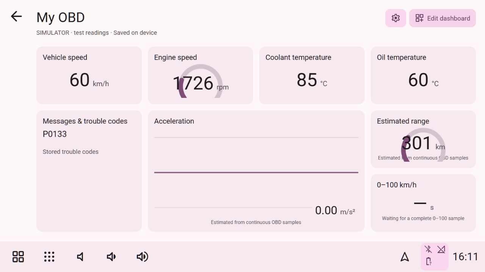

# Custom OBD dashboard

Open **Applications → Hudiy → My OBD → Edit dashboard**. This is an additional page in our independent application. The five existing OBD screens remain available.

*Local ELM simulator with synthetic data, not a live vehicle test.*

## Arrange your data

1. Choose **Add data**. Tap a reading to add it in the first free space, or drag it into an empty grid cell on a wide screen.
2. Drag a tile by its grip to move it. Compatible tiles swap places. Overlapping or out-of-bounds placements are rejected.
3. Use the arrow buttons for precise movement or on smaller touchscreens. The logical layout has four columns and eight rows; compact displays reflow those positions into one or two columns without changing the saved arrangement.
4. Open a tile's settings to choose its source, title, **Block**, **Gauge**, or **Chart**, and small, wide, tall, or large size. Messages use the block display. Up to 16 tiles can be saved.
5. Choose **Done**. Changes save automatically; wait for **Saved on device**. On a desktop preview without device storage, changes are saved in that browser instead.

The page uses the app's current colors and taskbar. Only drag grips consume dragging; the page remains scrollable. Mapping fields have an on-screen keyboard. The page can also be pinned through the existing long-press shortcut controls.

## Define a sensor

In **Add data → Custom sensor**, choose a template or a manufacturer data identifier. Enter:

| Field | Meaning |
| --- | --- |
| Read mode / PID | Mode `01` with a two-digit PID, or read-only Mode `22` with a four-digit manufacturer identifier |
| ECU CAN header | Optional 11-bit or 29-bit CAN request identifier; must match the adapter's active CAN protocol |
| Response bytes | Number of data bytes after the matching service/PID, from 1 to 8 |
| Formula | `A` is the first data byte, `B` the second, through `H`; e.g. `(A*256+B)/4` |
| Unit / min / max / decimals | Display metadata and gauge/chart scale; units are not automatically converted |
| Poll interval | Requested minimum interval, 1–60 seconds; adapter latency and the shared polling budget can make updates slower |

Supported operators are `+ - * / // % & | ^`, parentheses and unary signs. Calls, variables beyond A–H, powers, shifts and executable code are rejected. **Test formula** evaluates explicitly supplied sample bytes locally on the service; it does not send a vehicle request. For example, Mode 01 PID `5C`, one byte, formula `A-40`, unit `°C`, sample `64` gives `60 °C`.

Templates are starting points, not evidence that a vehicle supports a sensor. Manufacturer identifiers, ECU headers and formulas must come from the correct vehicle definition. This feature cannot unlock inaccessible ECUs, discover undocumented signals, perform security access or synthesize missing readings. Up to eight custom mappings are supported. Deleting a mapping also removes its tiles and range-input references after confirmation.

## Estimates and messages

- **Acceleration** comes from successive valid speed readings. It is a sampled estimate, not a precision accelerometer.
- **0–100 km/h** and **Best 0–100 km/h** are session estimates. A run requires two seconds at standstill followed by continuous valid movement to 100 km/h. Gaps over three seconds, invalid values, implausible jumps and incomplete runs do not produce a result. Session results reset on reconnect/service restart or changed input definitions.
- **Range inputs** requires tank capacity in litres, a fuel-level source returning percent and a fuel-rate source returning litres/hour. No default tank capacity is invented. Update these inputs at least every ten seconds. At least 0.1 km of valid speed/fuel-rate samples is required before average consumption or range appears. Gaps and invalid inputs reset integration. Range uses remaining tank fuel and the sampled average; it is not an OEM range prediction.
- **Average consumption** shows that same session calculation in L/100 km. Coasting with a zero fuel rate contributes distance.
- **Messages & trouble codes** reads stored Mode 03 codes at most every 30 seconds when selected. It displays codes and adapter/mapping errors, not a complete manufacturer diagnostic interpretation. Clearing codes is not offered.

Disconnected, stale or unsupported readings display a dash or an error. Charts contain bounded actual sample history with gaps. Simulator and Demo states are explicitly labelled; they do not establish live vehicle support.

## Diagnostic recording

Use **Logs** in the page header for configurable manual/automatic background recording and local CSV/JSONL export. Logging can read every stored custom mapping independently of visible tiles. See the [OBD logging guide](OBD_LOGGING.md).

## Storage and local API

The Pi saves `~/.local/share/hudiy-recreation/custom-obd.json` using private atomic writes with fsync before acknowledgement. It contains definitions/layout only; telemetry history and estimates remain in memory. Revisions reject conflicting writers rather than overwriting another window. Failed browser saves retain a local pending draft with explicit recovery/retry controls.

`GET /api/obd-dashboard` reads definitions and revisions. `POST /api/obd-dashboard` accepts only `{revision, config}` (16 KiB maximum). `POST /api/obd-formula` accepts a validated sensor and optional exact-length hex sample (4 KiB maximum). Existing loopback Host/Origin/JSON restrictions apply. Device persistence requires our Pi application; no cloud account, firewall rule or extra privilege is added. See [backend rules](backend-rules.md) and [security policy](../SECURITY.md).

The ELM worker keeps ordinary readings, adds at most two due custom queries per pass, and polls only selected custom sources or configured range inputs. Explicit ECU headers are restored to the normal diagnostic header before ordinary reads. Only validated read requests, fixed adapter setup and header selection are accepted. No arbitrary CAN payload, ECU write, fault clearing, actuator command, security access or caller-supplied destination is provided.

## Verification

Local QA uses the real HTTP handler and socket transport with a loopback ELM fixture, isolated storage and synthetic readings. It covers custom PID decoding, formula preview, DTCs, drag/drop from the source list, tile swapping, view selection, range inputs, reload and cold-service persistence, and compact touch controls. Automated tests cover schema/formula rejection, header restoration, optimistic saves, disconnect invalidation, sampling gaps and synthetic acceleration runs.

These checks do **not** verify a powered ELM327 in a real vehicle, its manufacturer PIDs, physical finger input, or this revision installed on the Pi. Native Android Auto code is unchanged by this feature.
