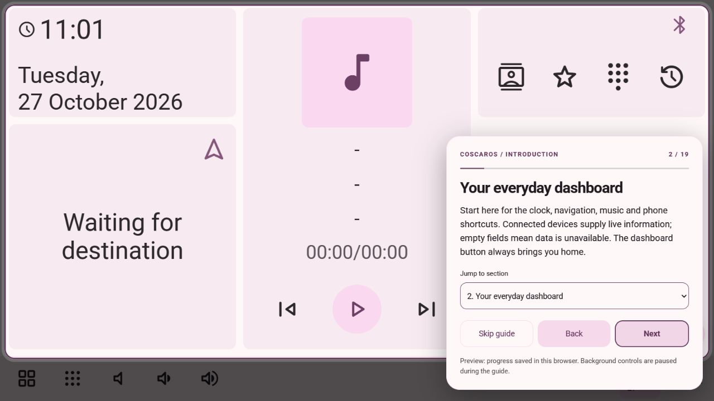

# New user guide

The built-in introduction opens automatically the first time this version runs in
a user profile. It highlights the actual application pages and explains controls
without operating devices. Park the vehicle before setup. The original dashboard
and saved settings are retained.

## Using the introduction

- **Start tour / Next** advances; **Back** revisits a section.
- **Jump to section** goes straight to a topic. There is no automatic advance.
- **Skip guide** opens a separate confirmation. **Keep learning** is focused first;
  **Confirm skip** is required to dismiss it. Outside taps do nothing; Escape opens
  this same confirmation rather than silently closing the introduction.
- **Finish introduction** saves completion and returns home.
- **Settings → System → Application → Replay introduction** starts again at Welcome.
  Replaying never resets your layouts, connections or preferences.
- Pending progress resumes after an app restart. Native progress is stored privately
  on the Pi; the desktop browser preview keeps its own progress in localStorage.
  An explicit save error keeps the guide open so you can retry.

## 1. Your first dashboard

The clock, navigation, music and phone cards form the default dashboard. Missing
readings or phone information are shown as unavailable, not manufactured values.
Press the dashboard shortcut to return here from other screens.

## 2. Taskbar and navigation

Applications opens the category browser. Volume and mute controls affect output;
Android Auto Resume returns to an existing projection session. Long-press a
shortcut to change its position; long-press an application to pin it. Swipe lists,
use wheel/keyboard navigation or the page's scroll arrows. Scrollbar chrome is hidden.

While the tour is open, background controls are deliberately paused. On the Pi the
separate taskbar shows an introduction-in-progress message. Finish or confirm Skip
before operating devices. A renewable 30-second native lease prevents projection
from covering the guide; it expires if the guide process stops.

## 3. Applications and Settings

Choose Phone, Music, Android Auto, Autobox or coscarOS on the left, then an item on
the right. coscarOS contains Settings, OBD views, My OBD, OBD Logs and Extensions.
Settings has System, Projections, Audio and Bluetooth categories. Back returns to
the previous view. Existing saved layouts can reorder these entries.

## 4. Customize the dashboard

Open **Customize dashboard** or **Settings → System → Dashboard**. Add widgets,
select one to rename or resize it, and drag its grip to move or swap it. Move
buttons and keyboard arrows provide alternatives. Appearance offers optional glass,
backdrops, accent, opacity, blur, rounding, spacing and motion. Preview changes,
then Save layout; Cancel keeps the saved dashboard. The Original preset restores
the familiar dashboard. See [Dashboard Studio](DASHBOARD_WIDGETS.md).

## 5. Layout sharing and Extensions

Open **Applications → coscarOS → Extensions**. Preview a bundled layout before
saving it in Studio. Import a shared JSON layout or export your saved layout.
Native exports go to `~/Downloads/coscarOS-Layouts/`; desktop previews use the
browser download flow. Packs contain layout settings only. They cannot execute
widget code. Online community downloads are a future feature.

## 6. Appearance and startup

**Settings → System → Theme** selects light/dark appearance and accent colors.
**Appearance** controls the clock, taskbar dimensions and black startup screen.
Black startup applies the next time the app starts. Physical brightness is
separate from theme/day-night appearance and depends on supported display hardware.

## 7. Pair your phone

After the tour, enable Bluetooth on the phone. Open **Settings → Bluetooth → Pair**,
scan and choose it, then approve matching pairing codes. Enable phone-side contact
sharing for phonebook access. Connections manages paired devices; Remove forgets a
device. Pair the phone, OBD adapter and optional radio receiver as separate devices.

## 8. Android Auto

For USB, use a data-capable cable and an unlocked Android phone; approve Android
Auto prompts. For wireless, pair Bluetooth, enable phone Wi-Fi and configure the Pi
hotspot in projection settings. Avoid VPNs that interfere with local projection.
**Automatic connection** controls reconnection; **automatic opening** separately
controls whether projection comes to the foreground. The taskbar visibility option
lets you retain coscarOS shortcuts. Resume reopens projection; Quit ends it and
pauses automatic reconnection until you explicitly reconnect or toggle its policy.
See the Android Auto setup sections in [installation](INSTALL.md). Apple CarPlay is not currently implemented.

## 9. Contacts and calls

Open **Applications → Phone → Contacts**. Use touch filters, Favorites, Call log or
the dialpad to choose a number; confirm the call deliberately. Contact sharing must
be enabled on the phone. **System → Contacts** sets phonebook refresh timing.
Microphone and call audio depend on supported hardware and Bluetooth routing;
contact sync alone does not verify audible calling.

## 10. Music

Choose a source under **Applications → Music**. Storage uses selected local audio;
Bluetooth and Android Auto use the connected source. Play/pause, previous and next
control that source. **System → Music** sets the metadata refresh interval, default
one second. Spotify Connect playback on a different device can leave the phone's
projected metadata unchanged. The tour never starts playback.

## 11. Audio output and equalizer

Open **Settings → Audio → Sound** to select output and set volume/mute. An optional
Bluetooth receiver connected to your radio is paired separately and selected as
output. It is not the ELM327 diagnostic adapter. Bluetooth → Connections also offers
**Use as audio device** for paired audio-output receivers. It saves the same output
preference and connects the receiver if necessary. Selected and actual route status
are shown separately; failures stay visible even with popups muted. Equalizer and
Presets adjust sound.
Selecting a receiver does not itself start music.

## 12. Microphone

Open **Settings → Audio → Audio input**. Choose a detected capture device, adjust
gain or mute and Save; Discard abandons edits. Missing hardware remains unavailable.
Opening this page does not start capture. Android Auto voice input and Bluetooth
phone-call audio use separate paths. See [audio input](AUDIO_INPUT.md).

## 13. Vehicle diagnostics

Power a compatible Bluetooth ELM327 from the vehicle, pair it and select it in OBD
settings. Connect when the vehicle is safely parked. Vehicle support determines
which standard or manufacturer readings are available; disconnected/stale values
must not be treated as current. The guided tour does not pair or connect adapters.

## 14. My OBD and custom sensors

Open **Applications → coscarOS → My OBD**. Edit the layout to choose data sources,
blocks, original gauge types, charts, sizes and positions. Custom read-only PID
mappings/formulas need vehicle-specific verification. A configured tile is not proof
that a car supports its sensor. The separate original OBD views remain available.

## 15. Diagnostic logging

Open **OBD Logs** from the application list or an OBD page. Choose manual recording
or automatic recording on adapter connection. Configure capture categories,
sampling and storage limits, then Record when needed. Stop and save the session;
review coverage/errors and export CSV or JSONL locally. The logger captures exposed,
supported data, not every proprietary signal. Keep diagnostic exports private.

## 16. Software updates

Open **Settings → System → Software updates**. Select notification/manual installation
or automatic installation while idle. Check for a version and follow preparation,
installation, health and recovery status. Use an internet-connected Ethernet or
suitable Wi-Fi route; wireless Android Auto can occupy the Pi's Wi-Fi. Install while
parked with stable power. Updates can restart the app. See [OTA updates](OTA_UPDATES.md).

## 17. Notifications and finishing setup

**Settings → System → Notifications → Enable popup notifications** is the master
switch. Off silences application popups while retaining individual category choices.
Confirmations and inline status stay available. Finish the tour, then pair your
phone, select audio, and connect the diagnostic adapter when available. Replay the
introduction any time from **System → Application**.

## Persistence and acceptance

Native progress lives in `~/.local/share/hudiy-recreation/onboarding.json`, written
atomically with the existing private/fsync storage helper. It records guide version,
step and pending/completed/skipped status only. The active navigation lease is
memory-only. The preview key is `coscaros.onboarding.v1`. Neither stores phone,
vehicle, account or location data. Existing profiles without this file receive the
introduction once when this feature is first installed.

- [x] Browser: first launch, progress reload, all section routes, finish/reload,
  Settings replay, Keep learning and confirmed Skip/reload checked. Narrow 390×844 layout has no horizontal overflow.
- [x] Automated: corrupt/missing state, bounds, save failures, durable reload,
  confirmation, lease renewal/expiry, API Origin/body limits and sanitized errors.
- [x] Build the updated native runtime on Raspberry Pi OS and pass all six native tests.
- [ ] Verify first install, both web views, real touch input, interrupted tour/reboot
  persistence, foreground
  protection during Android Auto connection, and lease expiry after renderer failure.

Production build and 51 frontend tests passed. The backend suite ran 279 tests
without failures, with ten platform skips. The runtime dependency audit reported
zero vulnerabilities. No standalone type-checker or linter is configured. The native
Qt executable was also compiled by OTA on the Pi, where all six native tests passed.

The tour was deployed to the reference Pi in `e4cca11`. First-run state became
active at step zero and both native views passed startup health/stability checks.
Real finger input, replay/skip on the physical display and cold-reboot/foreground
acceptance remain open. See [backend rules](backend-rules.md)
for the local API contract.
