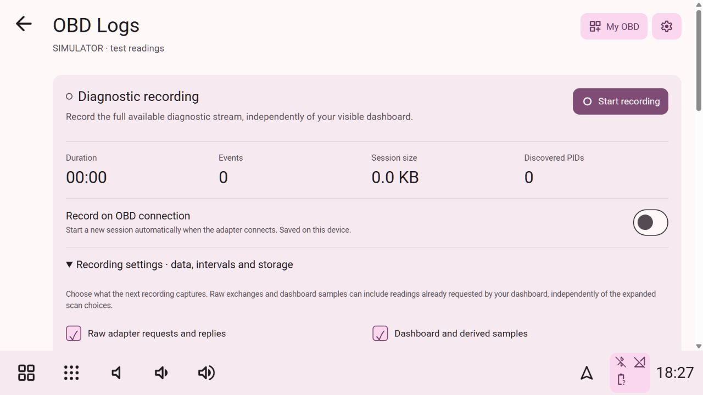

# OBD diagnostic logging

Open **Logs** from My OBD or any of the five original OBD views. You can also use **OBD connection settings → OBD Logs** or **Applications → Hudiy → OBD Logs**. The logger runs in our Python service and keeps recording while you change pages.

*Local simulator, synthetic readings. This is not evidence of a real vehicle test.*

## Recording mode

- **Manual:** turn **Record on OBD connection** off, then use **Start recording** and **Stop & save**.
- **Automatic:** turn the switch on. The next connection attempt starts a session early enough to capture initialization failures. A successful handshake is recorded separately. The same session continues through disconnects/reconnects, until you stop it or a limit/error stops recording.
- Stopping an automatic session leaves it stopped for the current connection. A later reconnection can start another session. Turning automatic recording off does not erase logs or stop an already active session.
- The preference persists on the device. New installations initially use manual recording; no particular mode is forced after you choose one.

## Configurable recording settings

Expand **Recording settings · data, intervals and storage**. These settings persist on the device. Capture/timing/storage choices are frozen when a session starts, so each recording has a consistent configuration; changes apply to the next session. Recording mode governs future connection attempts.

| Setting | Default | Supported range / effect |
| --- | --- | --- |
| Raw adapter requests and replies | On | Exact bounded commands/replies, requested ECU header, times and errors |
| Dashboard and derived samples | On | Existing live values, visible custom data, estimates and diagnostics |
| Read every configured custom mapping | On | Poll all stored mappings even when no tile selects them |
| Expanded live PID scan | On | Discover and read advertised Mode 01 PIDs |
| Freeze frame 0 | On | Discover and read advertised Mode 02 frame-zero PIDs |
| CAN monitor results | On | Discover/read advertised Mode 06 IDs on CAN protocols |
| Vehicle information | On | Discover/read advertised Mode 09 IDs; may include VIN/calibration data |
| Stored, pending and permanent codes | On | Read Modes 03, 07 and 0A |
| Extra scan interval | 1 second | 1–30 seconds, at most one extra request per ordinary polling pass |
| Dashboard sample interval | 1 second | 1–60 seconds |
| Fault-code refresh | 30 seconds | 10–300 seconds |
| Freeze-frame/monitor/information refresh | 60 seconds | 10–600 seconds |
| Maximum session size | 32 MiB | 1–64 MiB |
| Total log storage | 256 MiB | 16–1024 MiB; must fit the session limit |
| Maximum saved sessions | 20 | 1–100 sessions |

Use the presets or the plus/minus controls to select any integer in those ranges without a keyboard. Save or discard draft changes explicitly. Raw adapter traffic and dashboard samples are independent capture choices: they can contain readings already requested by the dashboard even if their *additional scan* category is disabled. Critical read-only validation and resource ceilings are enforced by the service.

## What “all available data” means

The recorder walks the ECU's support bitmaps instead of blindly guessing every identifier. It captures advertised standard live PIDs, frame-zero freeze data, CAN monitor results, vehicle information, requested fault-code responses, configured custom sensor definitions/results, session estimates, connection lifecycle and raw exchanges according to your settings. Common numeric PIDs have values/units; unknown advertised payloads remain hex/raw data. Coverage lists the discovered IDs and unavailable responses.

The adapter is serial and shared with the dashboard. Requests happen sequentially; more data and slower ECUs increase sweep time. The selected interval is a minimum, not a promise that every PID updates simultaneously or at that rate. A support bitmap is a vehicle claim, not proof that each later request will return valid data. Reconnect starts discovery again within the active recording.

This does not expose every proprietary module or undocumented manufacturer signal. Mode 22 needs a known custom mapping; no blind manufacturer scan, authentication bypass, arbitrary CAN payload, actuator control, Mode 04 clearing or Mode 08 control is provided. Legacy Mode 05 and manufacturer-specific freeze-frame histories beyond frame zero are outside this implementation. Unsupported/missing readings and errors remain visible; they are never replaced by invented measurements. Dashboard Demo animation is not logged as vehicle data. Loopback simulator sessions are explicitly labelled.

## Review and export

**View** shows the most recent 40 complete events (within a 64 KiB preview window). Expand an event to inspect its structured data and raw reply. Refresh the preview explicitly. The complete session remains available separately.

Stop a session before exporting:

- **Export CSV** writes a spreadsheet-friendly file to `~/Downloads/coscarOS-OBD-Logs/`. It contains UTC timestamps, elapsed time, event types, commands, ECU headers, sources, values, units, errors, raw replies and structured JSON. Additional `reading` rows flatten numerical dashboard/custom/derived samples for plotting. Numeric negative values remain numbers; formula-like textual cells are escaped.
- **Export JSONL** saves the complete event stream to that same fixed directory. Each line is an independent JSON event. Sensor definitions/settings and connection events help interpret the readings. Interrupted files retain their original bytes, including any incomplete final record.
- **Download JSONL** is available in a regular browser. The native Pi application can use the filesystem export buttons without relying on a browser download dialog.

Nothing is automatically uploaded. Vehicle information can identify the car; keep exports private until you decide to share them. Exports have a separate total-size ceiling equal to the current total-storage setting. Existing exported copies are separate from session storage.

**Remove** requires explicit confirmation and only deletes that finished session and its metadata. It does not delete exports. Full storage stops/refuses recording with a visible reason; older recordings are never silently overwritten or rotated away. Lowering limits does not hide or delete older sessions.

## Durability and limits

Sessions live in the private `~/.local/share/hudiy-recreation/obd-logs/` folder; settings live in `settings.json` there. Files use private permissions on Linux. A bounded 256-event queue decouples disk writes from adapter polling. Writes flush/fsync roughly every second, including idle periods, and on normal Stop. An abrupt power cut may lose the last buffered second; surviving unfinished recordings are labelled interrupted after restart. Normal app/service shutdown requests a flush when its cleanup path runs. This does not replace a safe ignition shutdown controller.

Storage, queue and write failures stop recording visibly; an interrupted session must not be treated as a complete capture. Recorded events are bounded, raw replies at most 4096 characters, and histories are not duplicated into each sample. Export preparation is serialized and bounded. Old valid sessions up to the hard 64 MiB ceiling remain exportable after reducing the next-session size limit. No additional package or cloud service is needed.

## Verification and references

Tests cover strict settings/action schemas, command/write rejection, advertised-PID discovery, code and freeze-frame decoding, a real loopback socket transport, hidden custom-sensor capture, automatic/manual recording, reconnects, private saves, idle flushing, quotas, interrupted recovery, path/symlink checks and CSV formula handling. Browser QA covers recording, saved settings, automatic start on a cold service connection, exports, continued recording across pages and compact layout.

Powered-vehicle/ELM327 support, physical touchscreen input, Pi deployment and power-cut recovery on actual hardware remain unverified for this revision. A log helps investigation; the software does not establish a repair diagnosis from codes alone.

Protocol scope was checked against the [ELM327 manufacturer's data sheet](https://elmelectronics.com/wp-content/uploads/2020/05/ELM327DSL.pdf), [python-OBD command documentation](https://python-obd.readthedocs.io/en/latest/Command%20Tables/), and [Snap-on service-mode documentation](https://www.snapon.com/DiagnosticsManuals/PDL/7100/EG/Content/Common/SMX_Scanner/OBDII%20Service%20Modes.htm). The implementation is our own and adds no python-OBD runtime dependency.

## Automatic capture improvements — 24 October 2026

Recording now retains ECU identity, validates multi-frame replies, preserves
long/partial traffic and per-reading acquisition times, prioritizes fault reads,
and automatically requests read-only UDS fault/status/details from discovered
standard CAN responders without a vehicle profile. Saved coverage distinguishes
an incomplete scan or connection-only recording from a finished file. Use
**Mark fault / power loss** to timestamp a symptom and expedite known reads.
See [automatic diagnostic capture](OBD_CAPTURE.md) for exact scope, limits,
reconstruction of split events and manufacturer-data limitations.
