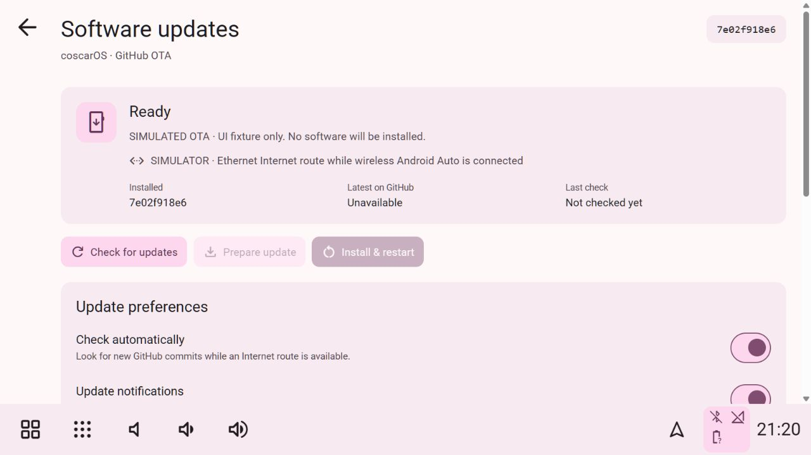

# Software updates over the air

Open **Applications → coscarOS → Settings → System → Software updates**. The app checks the fixed public GitHub repository `EpicNori/coscarOS`, branch `main`. It never accepts a caller-supplied repository, branch, shell command or download URL.



*UI fixture only. The screenshot does not establish an actual Pi update or Android Auto network test.*

## First installation

Install this OTA-capable revision once using the normal Pi installer, or deploy the complete revision and start its updated `implementation/launcher/launcher.py`. Older installations cannot acquire a new updater through a settings screen they do not yet contain. The desktop Vite preview is a UI preview; real activation requires the supervised Linux Pi launcher.

OTA source releases must contain `implementation/OTA_PROTOCOL` with the supported value `1`. Incompatible bootstrap/protocol changes or new system-package prerequisites need the normal installer. This update mechanism covers the application, frontend, Python service and native Android Auto runtime; it does not update Raspberry Pi OS, install sudo packages, or replace the known-working bootstrap supervisor through an unverified release.

## Manual or automatic

| Preference | Behavior |
| --- | --- |
| Check automatically | Check when an eligible Internet route is available; initially enabled |
| Update notifications | Notify through the existing themed notice system once per new/prepared version; initially enabled |
| Installation mode: Notify me | Announce a new commit; preparation and installation happen on tap |
| Installation mode: Automatic when idle | Prepare the update, then wait for the idle requirements before activating |
| Check interval | 1–168 hours, initially six; presets and plus/minus controls are available |
| Prepare during Android Auto | Allow background download/build while connected; initially enabled |
| Metered connections | Allow metered or unclassified routes only when explicitly enabled |
| Retained versions | Keep two to four managed copies, plus any protected active/previous/prepared copy needed for recovery |

Settings persist privately on the Pi. Save/Discard controls distinguish drafts from saved choices. Automatic mode requires 30 continuous seconds of fresh OBD speed **and RPM both zero**, no active call, no OBD recording, and Android Auto disconnected. Missing/stale OBD data causes it to wait. A zero-speed signal alone is not treated as proof that the engine is off. Hardware acceptance of these conditions remains necessary for each vehicle.

Manual activation requires explicit parked/restart confirmation, and still refuses known movement, active calls and OBD recording. An already built update can be activated offline. Install restarts the car application and briefly disconnects Android Auto; downloading/building does not itself restart or reconfigure it. Background compilation can affect responsiveness; disable preparation during projection if desired.

## Ethernet and Wi-Fi

The updater reads the existing default route and NetworkManager interface/metering state. It uses Ethernet or Wi-Fi without changing network profiles, starting a hotspot, dropping Android Auto, or changing radio mode.

- With wireless Android Auto using the Pi's `wlan0`, use Ethernet for Internet updates, or a separate Wi-Fi adapter with its own Internet route.
- Without that wireless projection conflict, an existing Wi-Fi Internet connection can be used.
- A local car hotspot or link/carrier alone does not prove Internet access. GitHub request failures leave the installed version intact.
- Metered or unknown-metering routes wait unless the corresponding preference is enabled.

The updater does not implement automatic home-network switching, simultaneous AP/client mode on one radio, phone tethering setup or a new network permission policy. An independent Internet connection remains necessary for source/dependency downloads.

## Preparation and activation

1. **Check** reads the `main` Git reference from GitHub. The API response is bounded and the commit must be a valid 40-character SHA.
2. **Prepare** downloads that immutable source archive over HTTPS. Redirects remain scoped to the same project on the allowed GitHub API/codeload hosts. Archive paths, types, entry count, sizes and reserved OTA markers are validated; links and path escapes are refused.
3. Build in a separate, final managed release path so native RPATHs remain valid. Run locked npm installation, frontend build/tests, backend tests, native CMake build and CTest. No sudo, apt, OS service changes or modification of the running source checkout occurs. The private Node runtime installed by the normal installer is reused.
4. Only successful checks create the ready manifest. At least 4 GiB free space is needed before preparation; a build stops before exhausting the 512 MiB reserve. Builds have bounded output/time limits and use one native compile job at lower CPU priority. Cancel leaves the active version selected and pauses automatic retry of that revision until a manual preparation or a newer revision.
5. **Install** atomically selects the prepared version, then requests our native app to exit. The stable launcher starts that version and injects its exact source revision and a fresh activation token.
6. The new content renderer acknowledges that it loaded; the backend must also have native IPC and at least ten seconds of uptime. The launcher requires 30 seconds of process stability and gives startup up to 90 seconds. Missing health, an early exit or launch failure restores the previous version. Successful updates do not consume a lifetime restart limit.

Settings and diagnostic recordings remain outside release directories. The updater does not migrate or restore private preference schemas; new application releases must remain compatible with those schemas. A software rollback is not a backup of every future data migration. The original installed source/build stays available as the baseline.

## Recovery

Use **Restore previous version** in Software updates while parked. Automatic installation will not immediately reinstall that same revision after rollback. Newer GitHub revisions or explicit manual actions can proceed.

For offline maintenance recovery, quit the running app (the existing `Ctrl+Alt+Shift+Q` shortcut remains available), then run the **original installed checkout's** launcher:

```sh
python3 ~/hudiy-recreation/implementation/launcher/launcher.py --baseline
```

Use your actual original installation path if different. This selects the existing baseline and starts it; it does not fetch code or change saved car settings. A normal installer run builds/tests the baseline and selects it again, retaining a valid prior managed copy for recovery. Invalid/missing selected release files also fall back to a valid previous copy or the baseline.

Private update files are under `~/.local/share/hudiy-recreation/software-updates/`: settings/status, atomic selection, bounded build log, health markers and managed releases. Build failures retain the current application. Only validated unreferenced managed release directories are pruned. Incomplete builds are never activatable and can be replaced on retry.

## Trust and verification

See the [25 October 2026 real-Pi OTA acceptance record](OTA_VERIFICATION.md). The repository-rename and headless terminal-test failures were reproduced and repaired. Real managed activation, native/UI health, manual rollback, reinstallation and managed-release reboot passed on fresh Trixie. Vehicle-driven automatic activation and interruption checks remain open.

This is a fixed-repository, HTTPS/commit-pinned source updater. It executes that project's build scripts and lockfile dependencies as the desktop user. The downloaded archive digest is retained, but it is **not** an independent publisher signature or reproducible-build proof. No additional firewall rule, public listener, cloud account, token store or root runtime service is introduced.

Local automated checks cover strict settings/API boundaries, route/metering policy, source extraction, build-path stability, ready markers, activation rollback, confirmation/interlocks, startup health, repeated updates, restoration after crash/timeout/launch failure, and normal-installer selection. An actual public GitHub reference/archive download and bounded extraction succeeded without executing the downloaded source. Earlier gallery/UI checks use an explicitly simulated updater; the later acceptance report records actual Pi operations.

Native ARM64 compilation and all six CTests now pass on the existing reference Bookworm Pi. A real managed update, rollback, reinstallation and normal Pi reboot now pass on fresh Trixie; the exact scope and remaining hardware/interruption checks are in the acceptance report. A physical abrupt power cut was not performed. OTA requires a one-time deployment of this new code; an older published repository version without the protocol marker cannot be silently activated as an OTA release. See [backend rules](backend-rules.md) and [verification](VERIFICATION.md).

Protocol endpoints follow GitHub's [Git references API](https://docs.github.com/en/rest/git/refs#get-a-reference) and [source archive documentation](https://docs.github.com/en/repositories/working-with-files/using-files/downloading-source-code-archives). No repository credentials are required for the public project.
