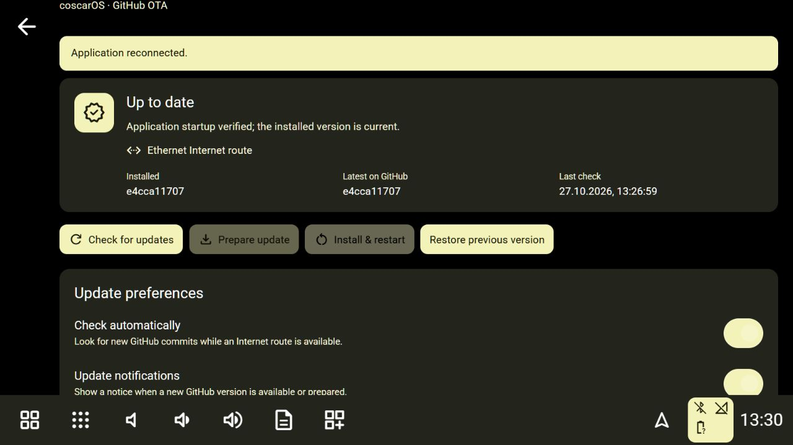

# OTA acceptance test — 25 October 2026

This records successive real reference-Pi tests, separately from mocked/UI-fixture
checks. The later fresh-Trixie run **passed managed activation, native/UI health,
manual rollback, reinstallation and managed-release reboot**. Automatic activation
with actual vehicle data and interruption acceptance remain open. Earlier sections
retain their historical results; see [the current README acceptance report](README_TEST_RESULTS.md).

## Failure reproduced and repair

The installed baseline was `ce71dc0599185d4607ddd114ce8271709db041f1`. Its updater still requested `EpicNori/clean-room-reverse-engeenering-hudiy`. After the repository became `EpicNori/coscarOS`, the old strict redirect handler refused the changed repository path with **Unexpected update download redirect**. The repository rename had been published without migrating that installed updater.

The current public source already uses the new fixed repository/archive root. On this Pi, a reversible backport changed the old updater's exact repository name, archive root and display user-agent. The original file and private settings were backed up, then the owned app was restarted. The independent native baseline and other source files were retained; this was a one-time migration repair, not an OTA acceptance result in itself. Strict HTTPS/host/repository/extraction restrictions remain enabled. The next Check succeeded.

The owner authorized stopping/saving the existing disconnected OBD recording for restart tests. Automatic recording was temporarily disabled to prevent a new connection-attempt recording from blocking each restart; its original settings were saved and restored while activation awaits parked confirmation. Original update preferences were also restored. No diagnostic sessions were deleted. No phone call, playback, pairing, hotspot reconfiguration or OS package installation was performed.

## Real release preparation

The running updater fetched GitHub revision `834903f862fe5be7461a923d230c6dc72f678eff`, extracted it into a separate final managed release directory, ran the real build/test commands and created its ready manifest. It did not build over the running source or borrow the old native executable.

| Check | Observed result |
| --- | --- |
| Fixed GitHub check after migration | Passed; current main revision discovered |
| Source download and extraction | Passed; exact coscarOS archive root accepted |
| Downloaded archive SHA-256 | `09d22c5f5634d8ae864e2ee7f18fa2b5671a8a74e63942077ac2214ebb6f36038` |
| Locked frontend install and production build | Passed on the Pi |
| Frontend tests inside the OTA build | 35 passed |
| Backend tests inside the OTA build | 237 passed on Linux |
| Native Release build | Passed on the Pi; one compile job |
| Native CTest | All six passed |
| Ready manifest | Created only after the checks; incomplete marker removed |
| Preference integrity before activation | All 13 top-level JSON preference files matched backup hashes |
| Actual settings UI | Shows real build/ready status, source revisions and Ethernet route |
| Automatic-idle preference | Saved through the real UI; correctly waits for fresh stationary OBD data when no adapter is connected |
| Manual preference | Restored through the real UI before requesting activation |
| Invalid requests | Actual API rejected missing parked confirmation (400), unknown update action (400), and foreign Origin (403) |
| Installation and renderer health | **Not yet run**; owner subsequently selected clean installer testing |
| Manual rollback and reinstallation | **Not yet run** |
| Persistence through controlled Pi reboot | **Not yet run** |

Ethernet supplied Internet access. `wlan0` was in AP/shared mode for the car hotspot; a GitHub request explicitly bound to it had no Internet route. This is not a client Wi-Fi update test, and the test did not switch off the car hotspot or alter network profiles. Client Wi-Fi and Ethernet policy alternatives retain automated coverage.

## Recovery and regression checks

The local Windows suite passed **241 backend tests with four platform skips**, all **35 frontend/packaging tests**, the production build and the runtime dependency audit (zero known advisories at this check). No coverage percentage was measured.

Four additional [real child-process recovery tests](../implementation/service/test_ota_process_recovery.py) passed on both Windows and the Pi. They use isolated temporary selection/release fixtures and actual owned subprocesses to verify successful health confirmation, early-exit recovery, stopping an unresponsive candidate, and rejection of the wrong health token. They verify process/supervisor behavior, not the real native renderer or vehicle hardware. Existing OTA regressions also cover failed preparation, strict archives, parked/call/recording interlocks, metering and network policy, nonce matching, repeated updates and previous-version selection.

## Subsequent installer test

The owner subsequently confirmed that the vehicle was parked and requested a
clean application uninstall/reinstall before further OTA testing. That test
archived the old baseline/staged release in private recovery storage and installed
a fresh baseline. Its successful boot does not verify managed OTA activation or
rollback. See [installer acceptance](INSTALL_VERIFICATION.md). The checklist below records the later managed-release retest; parked confirmation is established.

## Later fresh-Trixie retest

The updater on the freshly installed `51e0f57` baseline first exposed an unrelated
headless-test SIGHUP failure. The terminal helpers were repaired with `O_NOCTTY`
and real session-leading subprocess regressions. GitHub revision `152596f` then
built with 252 Linux backend tests, 35 frontend tests and six native CTests,
activated and passed normal UI/native health and process-stability gates.

The actual native executable was under that exact managed release. Manual rollback
started the real baseline executable, preserved preference hashes and paused
immediate automatic reapplication. Reinstallation passed health again. Enabling
both Android Auto switches caused wireless projection to open after that restart;
opening Off was restored afterward. A normal Pi reboot selected the managed release
and preserved all seven current top-level preference files. The owner reported no
visual boot flashes. The initial wireless cold boot exposed inactive car mode;
its separate recovery repair and retest are documented in the README report.

Preparation cancellation retained the installed app and ready UI. Automatic-idle
mode waited for fresh stationary OBD evidence when no adapter was available.
A later real active call also caused manual OTA activation to be refused; the test
did not hang up or bypass that interlock. Ethernet carried the actual downloads.

## Remaining acceptance

- [x] Confirm the vehicle is parked.
- [x] Prepare/activate a release through the real app on the newly installed baseline.
- [x] Verify the native process comes from the managed release, reports the exact installed SHA, reaches UI readiness and leaves pending verification only after the normal stability gate.
- [x] Restore the previous baseline, verify its actual process/source identity, then reinstall the prepared release.
- [x] Reboot normally and verify that boot startup selects the managed release and retains preferences.
- [x] Restore the original automatic recording and update preferences while waiting for activation; no sessions were deleted.
- [x] Compare current fresh-image preferences across activation/rollback and all seven top-level JSON files across reboot; no saved recording was deleted. Live vehicle recording remains untested.
- [ ] Test actual automatic activation with fresh real zero-speed/zero-RPM data when vehicle hardware is available.
- [ ] Test a client Wi-Fi Internet route separately from car-hotspot mode, and controlled network/power interruption recovery. No abrupt power cut or corruption of the working installation is justified by the current results.

The install-dialog action was blocked by automatic approval review because the parked state had not yet been explicitly confirmed. The earlier authorization to save the recording did not establish that prerequisite. No bypass or alternate activation path was used. See [OTA operation and recovery](OTA_UPDATES.md) for the normal behavior and [backend rules](backend-rules.md) for trust boundaries.

## Hotspot repair power-on retest

The owner explained that the final unreachable interval was a switched-off Pi.
After power-on, `e479050` started through the normal car session, was current with
no pending restart, restored the enabled protected hotspot and connected wireless
Android Auto with decoded video ready and no error. Only USB root hubs were present.
All seven private preference hashes matched. The owner confirmed automatic opening,
then manually returned to the dashboard. Temporary settings/layouts were restored;
music refresh follows the later one-second request. See [the device report](README_TEST_RESULTS.md).

## Published UI update activation

GitHub source `0db7f7e983787fe61f3ecdc969cfdb233f3e63fc` (one-second music default
and globally hidden scrollbars) was subsequently downloaded, built and activated
through the actual updater. Its build passed 259 Linux backend tests without skips,
35 frontend tests and all six native CTests. The managed native executable reached
UI health, cleared pending verification and reported current; wireless video
reconnected while automatic opening Off kept the dashboard visible. All seven
preference hashes matched, including the applied 1-second music and 60-second
contact intervals. The new scrollbar behavior was verified on the actual Pi using
wheel and drag scrolling. No vehicle recording was started or existing session
removed. The dependency audit found zero known advisories. These results do not
complete the unavailable vehicle, microphone/radio or physical-finger tests.

## GitHub owner migration repair — 27 October 2026

The reference Pi reproduced `Unexpected update download redirect` in its live
`0db7f7e983787fe61f3ecdc969cfdb233f3e63fc` updater. Its source still used
`EpicNori/coscarOS`. The public endpoint redirected to a numeric GitHub repository
path, rejected by the existing strict source guard. Ethernet was allowed/unmetered;
there was no active recording or call, so this was not a network or idle interlock.

A minimal owner-URL hotfix was backed up and applied to that active release and
`~/coscarOS` recovery baseline. Backup/repair hashes are kept privately at
`~/.cache/coscaros-ota-owner-20261027/`. The same supervised session was restarted.
The Pi then reported repository `desquerteur/coscarOS`, phase `available`, and the
published main revision `7fdd22896671b3f9130c21d29fc7266574a55bb8`.

The local repair requests the canonical owner directly, retains redirect/archive
protections, migrates exact historical installer origins, and adds clear bounded
HTTP/network failure messages. Local verification: 28 updater/supervisor tests
passed; the full backend suite ran 279 tests, ten skipped, no failures. A real
canonical API check and 1,300,968-byte checked source archive download/extraction
also passed. Those are check/download validations; native staging, activation and
rollback for this repair must be recorded separately below. The owner approved publishing all completed work, including the guide and Bluetooth
audio shortcut. The previously published candidate was cancelled during native
compilation so the final published revision can receive a fresh OTA test.

Installer migration smoke checks on the Pi also passed for the current owner and
both exact historical origins; a foreign owner was refused before fetching. Git
and installer operations were stubbed, so this test made no OS changes. The source
was tested with the LF line endings used by GitHub. Native preparation of published
`7fdd228` has passed its frontend and Python service tests and is building the
independent receiver; activation has not yet been attempted for this repair.

### Published repair prepared successfully on the Pi

All completed changes were published as
`e4cca1170711ba74d19272686da75048c71fc73d`. The repaired updater fetched that exact
commit from the canonical GitHub source, built the production frontend, passed all
51 frontend tests and all 279 Python tests on the Pi without skips, compiled the
native receiver and passed all six native CTest checks. It reported **Ready to
install** with the matching prepared revision. The Pi-served update page also
showed the correct version and enabled Install & restart only after preparation.

At that preparation checkpoint, activation was waiting for a fresh parked/restart confirmation from the owner.
Download, build and tests are verified; successful activation/health and rollback
for this specific revision are not yet claimed. The running baseline remains
`0db7f7e983787fe61f3ecdc969cfdb233f3e63fc` with the source-owner hotfix.

The owner then confirmed the vehicle was parked and authorized activation. The
actual Pi-served UI's Install & restart action selected `e4cca11`, both native web
views reached `uiReady`, and the launcher completed its 30-second stability window.
The selection's pending flag cleared automatically. A subsequent UI Check for
updates succeeded against `desquerteur/coscarOS` and returned **Up to date** with
`e4cca11` installed. The native first-launch introduction also reported active,
pending step zero, as intended for the existing profile's first use of this feature.
Rollback/reinstallation acceptance is being checked separately before leaving the
new release running.

### Activation, manual rollback and reinstallation passed

The owner authorized the parked restart. Installation through the real Pi-served
update UI passed. Manual Restore previous version then returned to `0db7f7e9`,
including a successful stability/health window. Reinstalling the cached verified
`e4cca11` release passed again without rebuilding. The final state was:

- Source: `desquerteur/coscarOS`.
- Installed: `e4cca1170711ba74d19272686da75048c71fc73d`.
- Phase: `current`; pending restart: false; native `uiReady`: true.
- A fresh GitHub Check succeeded after initial activation.
- Update preferences matched their values before the test; no call or recording
  was active. The native introduction remained available for the owner to watch.

The screenshot is the production update UI served by the actual Pi through a local
SSH tunnel, displaying real updater state. It is not a physical-display capture.
The API/launcher checks confirm deployment and stability; no phone/audio/vehicle
behavior is inferred from this screenshot. Forced startup failure, cold boot and
automatic idle activation with live stationary OBD data were not repeated in this
repair run. Private repair/acceptance records remain on the Pi under
`~/.cache/coscaros-ota-owner-20261027/`.

The final verification-notes commit changes documentation/images only; it is not
a second application binary deployment. The installed/tested application remains
`e4cca11`.
