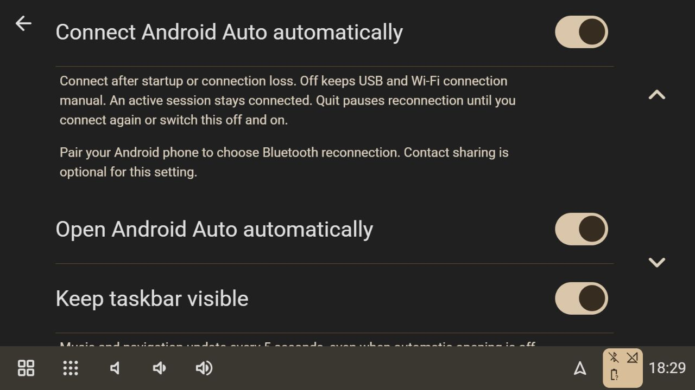

# Independent engine verification

Checked on the owner's Raspberry Pi 5, aarch64 Debian 12 Bookworm/labwc, Qt 6.4, 1280×720. These checks refer to our native executable, separately from historical tests of the licensed Hudiy bridge.

## Verified on our engine

- Pinned GPL protocol library and our Qt/libusb/FFmpeg executable compile. The initial 640×480 startup bug was corrected using the current screen and delayed fullscreen request.
- Our fullscreen process owns the Python backend and private Unix IPC. Proprietary Hudiy was stopped, its API port 44405 was absent, and our phone session still displayed genuine wireless Android Auto video.
- Thousands of H.264 frames were decoded. PCM audio bytes were received and written; this proves transport/output activity, not audible quality.
- Our taskbar remained below projection. Dashboard and Applications switched to our interface without ending the phone session. An injected single touch opened Android Auto's application launcher.
- With automatic opening off, the connected phone supplied background data. Manual Resume opened projection. Android Auto Quit prevented automatic reopening; later Resume reconnected real video through our handoff.
- Taskbar disabled used full 1280×720 projection. Taskbar enabled restored our bar. Changing this option now schedules one bounded handoff after session shutdown; reconnection was observed.
- Android Auto Night displayed dark Maps. Common was restored. Physical brightness changed the kernel backlight to 25/31 and back to 31/31.
- Phone title, artist, advancing position and cover art reached our dashboard. Unknown duration now displays an em dash; a regression test checks the unknown-timeline distinction.
- A real OS reboot started our independent app. Proprietary Hudiy and its OBD example did not start. Layout, refresh, projection, wireless and OBD preference hashes matched their pre-reboot values.
- The per-paired-phone reconnect switch is separate from automatic opening. Both states were checked through the UI and private saved file. The existing reconnect worker is bounded to one attempt per device per 30 seconds and loads saved choices at startup.
- Real USB projection now decodes H.264 frames and receives PCM bytes, with our taskbar beneath Maps/Spotify. Capture 344 records wired video. The corrected accessory manufacturer/model is Android / Android Open Automotive Protocol.
- Reinstating the audio-input protocol descriptor fixed the phone closing immediately after service discovery on both USB and wireless. Capture 345 records live wireless video after the fix: more than 900 frames and 6 MiB audio received. The Pi has no usable microphone; capture requests return failure rather than sending invented audio.
- USB software reconnect was checked with the hotspot still enabled: pausing the competing wireless bootstrap restored wired projection without a cable unplug. Android Auto Quit then reported disconnected/hidden; Resume produced more than 880 fresh frames. Captures 346–347 record these checks.
- Switching explicitly from USB to Wi-Fi restored more than 940 wireless frames. Dashboard then received Android Auto title/cover art/playing status while projection stayed connected but hidden; unknown duration displayed an em dash (capture 348). Proprietary Hudiy remained absent and port 44405 was not listening.
- Current checks pass 116 backend tests, 16 frontend tests, production frontend build, real Pi native compilation and the native DSP CTest. The same signal check passes AddressSanitizer/UndefinedBehaviorSanitizer on the Pi.

Private captures 325–337 record independent projection, taskbar, theme and artwork checks. Capture 322 is the initial sizing failure; 332 is a disconnected transition, not projection proof. Captures 338 onward record post-reboot investigation. Phone data and screenshot pixels remain outside the public repository.

## Reconnection after the reboot

Our app, hotspot and Bluetooth handoff started, but the phone completed negotiation and closed before video. Its screenshot showed communication error 21 concerning a VPN. The owner disabled the VPN. Subsequent investigation identified two receiver bugs: the USB accessory identity did not launch the phone handler, and omitting the audio-input service when hardware was absent caused the phone to close after service discovery. Both were corrected; real USB and wireless video were observed again. This does not yet establish unattended cold-boot or out-of-range recovery.

## Hardware checks still pending

- Required live ELM327 readings: the owner confirms the powered adapter/vehicle is unavailable. Simulated values are not real vehicle evidence.
- Unattended cold boot, physical multitouch, microphone/audible audio, active guided navigation and wireless out-of-range recovery.
- Optional Bluetooth car-radio receiver and audible music/navigation/conversation/incoming-call audio. No receiver is selected for these tests.
- Fresh provisioning of standard BlueZ/PBAP, oFono and PipeWire services. The reference Pi already had those configured. Independent inactive AP preparation is implemented and checked, but activation on a fresh image and complete standard-service provisioning remain unverified; see [hotspot setup](HOTSPOT_SETUP.md).
- Ignition power-loss protection and controlled shutdown require separate hardware work.

No new real call or explicit Play/Next/Pause command was used during this migration. Phone-side track changes are not a playback-control test.

## Native audio integration check

- Our C++ processor preserves Flat bit for bit, gives approximately ±6 dB at a selected band center, retains filter state across split packets, handles both balance extremes, leaves mono speech intact and bounds peaks. Invalid/nonfinite gains are rejected. CTest and sanitizer checks run synthetic samples without phone playback commands.
- The live Pi acknowledged the Flat settings. Saving produced a 0600 private preference file; an actual app restart reloaded the same settings and the native process acknowledged them again.
- The initial quarter-second pending queue overflowed during a live burst. Draining before admission and bounding the remaining queue to one second per channel corrected that check. Over the subsequent 20-second observation, audioBytes advanced from 2,495,616 to 6,153,344, queued bytes stayed around 35–40 KiB, maximum packet size was 8,192 bytes, and audioDroppedBytes remained zero. Wireless video stayed connected/visible/ready with no runtime error. These numbers show processing/output activity, not an audible-radio or microphone test.

## Hotspot preparation and longer audio observation

Our normal-user installer now prepares its own inactive, protected 5 GHz NetworkManager profile and private configuration. An actual temporary profile was persisted/read/deleted through its D-Bus adapter with active connections unchanged, and private settings roundtripped at 0600/0700. Eleven installer tests pass on both development Windows and the Pi. The existing production profile was bound to the expected wlan0 interface without activation/restart; repeated `--apply` reports installed/unchanged. D-Bus omits the default-true autoconnect value in some replies; this was corrected and regression-tested. See [full setup scope](HOTSPOT_SETUP.md).

A subsequent longer real wireless audio observation reported `audioDroppedBytes: 195456` and `Audio output could not keep up`, while projection still had decoded video. This contradicts any broader inference from the earlier zero-drop 20-second check. Sustained audio buffering and audible hardware output remain incomplete; no new Play/Pause/call command was used to obtain this observation.

## Standalone-only source cleanup — 10 October 2026

The owner requires all official Hudiy dependencies to be removed while retaining standard open-source libraries. The legacy API/configuration/audio bridge and its launcher have been removed from production source. Generic private persistence and handshake encoding are in runtime_support.py; optional audio receiver helpers are in audio_route_support.py. Our direct OBD monitor and owned-PID audio route retain their regression checks. All 92 current backend tests pass. The previous 116-test checkpoint included retired tests of the removed bridge.

This is a source cleanup; the earlier Pi video/audio/frame evidence above remains historical evidence of the independent engine. A new Pi deployment and live projection regression check are still needed for this exact revision. Clean-image provisioning of Bluetooth, HFP and audio remains an acceptance requirement.

## Guided installer checks

The fresh-Pi installer is implemented for 64-bit Bookworm/Trixie Desktop. On the existing Pi: package resolution passed in apt simulation, the piped bootstrap passed syntax/read-only checks, an official Node 22.23.3 ARM64 release was checksum-verified/extracted/run, and all 103 current backend checks passed in a clean source snapshot, including 11 installer checks. On Windows, Linux apply-flow/internal-symlink checks are skipped. The old deployment still contained retired bridge files, so its broad discovery failed; the clean-snapshot check excludes those files according to the maintained repository manifest. No sudo package/service/autologin installation was executed against the running reference app. Full freshly flashed image installation/reboot and Trixie compilation remain pending. See [installation scope and recovery](INSTALL.md).

## Dedicated audio worker — 10 October 2026

The previously running Pi receiver had reached 777,088 dropped audio bytes. Its push-mode sink feeding and DSP processing shared the GUI event loop with video decoding. A controlled, opt-in Qt 6.4 test sent synthetic silence to the existing `auto_null` sink while repeatedly stalling the GUI for 120 ms every 700 ms. The old code dropped 391,808 of 5,810,496 submitted bytes; its maximum feed gap was 126 ms. The new worker delivered all 5,675,904 submitted bytes, dropped zero, ended with no queued bytes and recorded a maximum worker feed gap of 12 ms. Runs submit according to actual elapsed time, so total input sizes can differ. No real playback/call command or physical output was used by this probe.

Our worker owns all three output sinks and DSP processors on its own Qt event loop. The GUI supplies bounded PCM through a locked mailbox; no PCM-bearing queued Qt calls can accumulate without limit. Each channel retains at most one second of raw input, one processed chunk of at most 8,192 bytes, and the separately requested 100 ms sink buffer (actual Qt buffer size can differ). Overload removes only the oldest complete frames and resets DSP at the discontinuity. Stops/restarts change the channel generation and discard old queued samples. Output errors retry at most once per five seconds while the phone stream remains active. Recovered backlog warnings clear; cumulative drop/overflow counters remain available.

The current native source compiled on the Pi and passed both native CTest checks. All 104 backend tests pass directly on its deployed source. Eight stale retired bridge files were moved to a recoverable directory outside `implementation`; this corrects the earlier deployment-pruning limitation. Application Quit exited the old owned process, and our normal launcher started the rebuilt engine. Wireless Android Auto reconnected and decoded real video; captures 349–350 privately record dashboard/artwork and projection with our bottom taskbar. Initial live observations wrote more than 26 MiB of PCM with zero drops, no runtime error and maximum worker feed gap 15 ms. Full physical audio, speech/calls, long-duration clock drift, output-device recovery, cold boot and a fresh image remain acceptance requirements.

The silent-sink probe is built when `BUILD_TESTING` is on but is deliberately excluded from default CTest. With a confirmed null sink only, run `implementation/native/build/hudiy-audio-output-stress old auto_null` and then `implementation/native/build/hudiy-audio-output-stress worker auto_null`. It refuses ordinary physical sink names. Numerical per-channel diagnostics are returned in the existing projection status; queued PCM is never published or logged.

## Notifications correction — local verification, 10 October 2026

The original Notifications controls now govern output/input/track notices and their 1–15-second duration. Action/error toasts retain their separate Toast duration. Popups follow the selected light/dark accent, and position/cover-art polling or reconnecting the same song does not repeat a track announcement. Disabling a switch clears its own current notice. Compact switches have 48px touch targets. Sound output volume/mute use the existing PipeWire action in either web view.

An application-owned, plain-text Qt overlay has been implemented so notices can appear above Android Auto and the taskbar instead of being clipped by the taskbar's short web view. It has an offscreen CTest for bounds, priority, colors, timeout and plain-text/input behavior. **That new native test and receiver compilation have not run yet:** the Pi sent a shutdown message before deployment. No new build was uploaded or restarted. Browser UI/drag scrolling and backend schema checks are verified locally; native projection/touch behavior is pending. Input level/mute remain saved preferences, not verified microphone controls. Source publication does not establish device acceptance.

## Automatic connection versus automatic opening

Android Auto settings now expose **Connect Android Auto automatically** independently of **Open Android Auto automatically**. The former controls USB discovery/admission and wireless recovery; the latter controls showing the projection screen. Enable both for unattended startup, or leave opening Off to receive background metadata. Existing sessions are preserved when connection is turned Off. Quit pauses retries, manual USB/Wi-Fi/Resume remains available with connection Off, and toggling connection Off/On resumes automatic admission. Choices are saved on the device.

Car Wi-Fi is still required for wireless use. A single paired phone is the default Bluetooth target unless explicitly disabled; choose targets when several phones are paired. Recognition uses phonebook, hands-free or phone-class information rather than requiring contact-sharing consent. Automatic wireless recovery runs on a five-second scheduler with a 30-second attempt limit, waits while sessions are connecting/active, retriggers an existing handoff or asks BlueZ for the selected phone's AA profile. Some phones support only incoming handoffs, so end-to-end recovery must still be checked on the actual phone.

This change was implemented with the Pi off and is **not yet deployed or hardware verified**. The native admission policy is included in CTest; compile it and follow [the README acceptance checklist](../README.md#android-auto-automatic-connection-acceptance) before treating cold-boot reconnect as verified.

